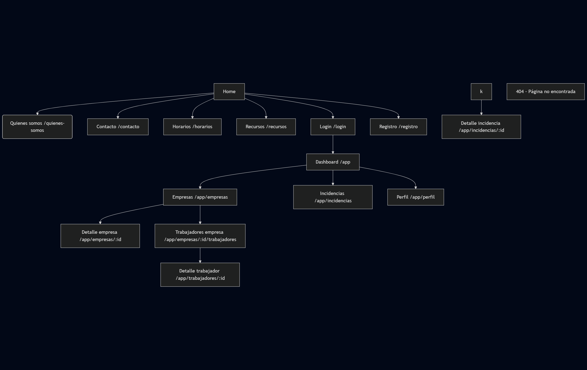
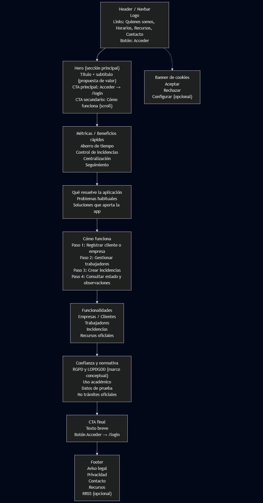
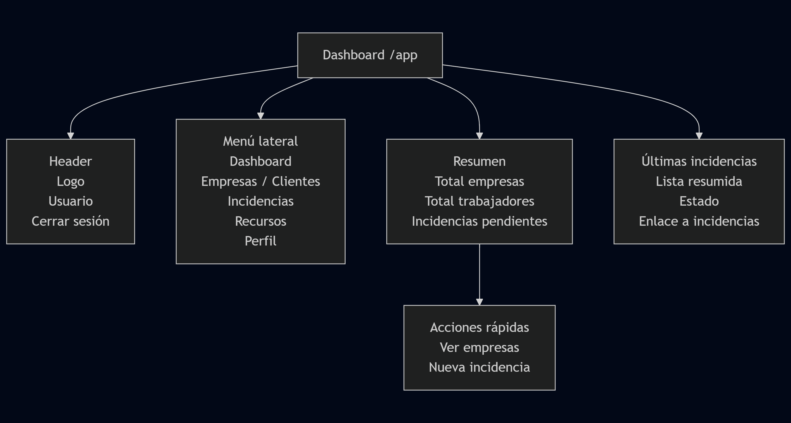
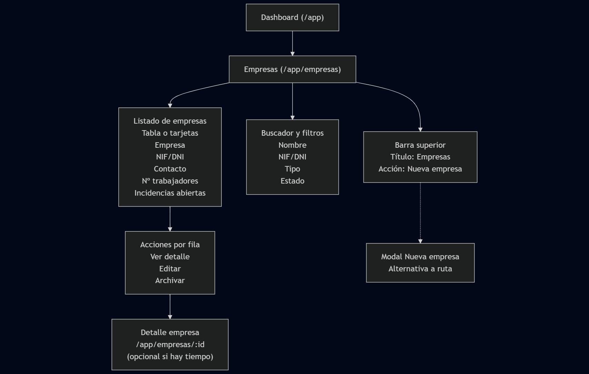
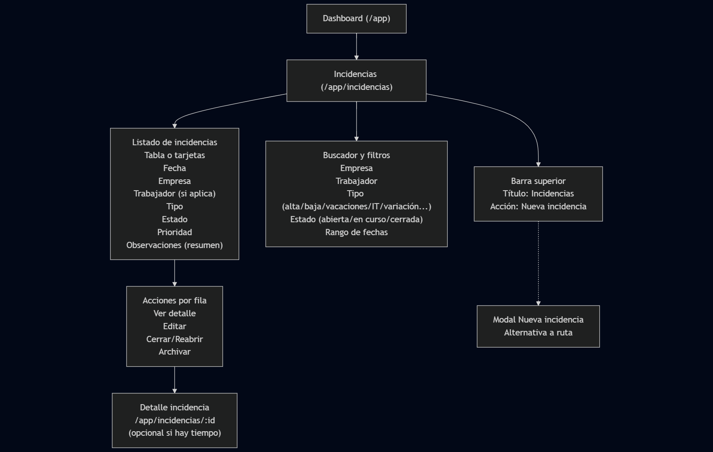
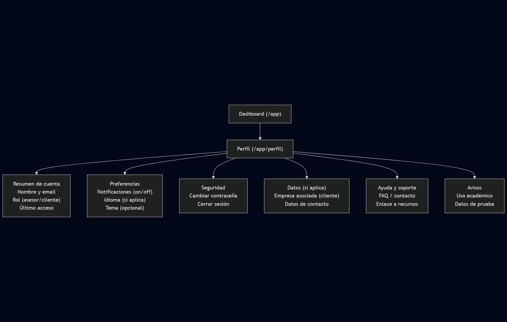
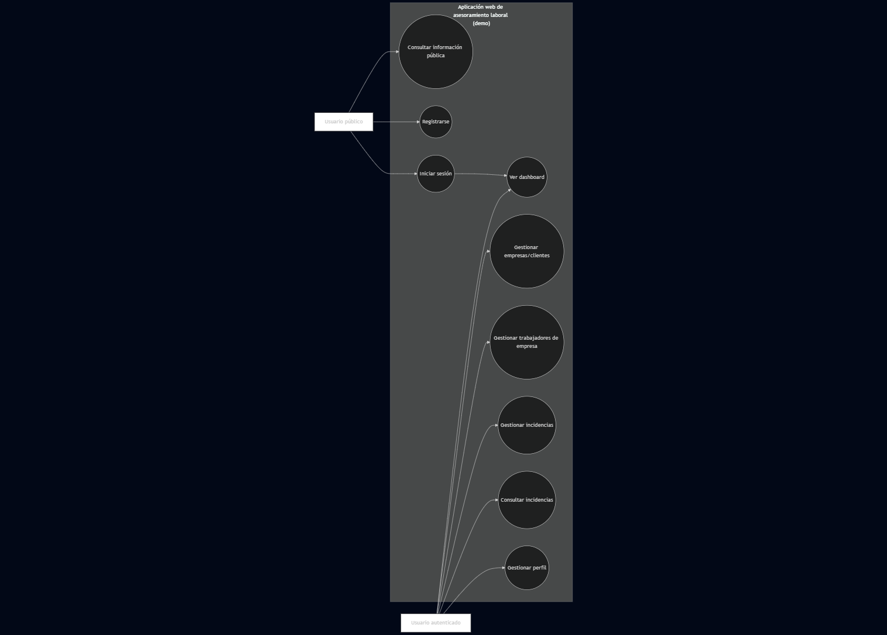
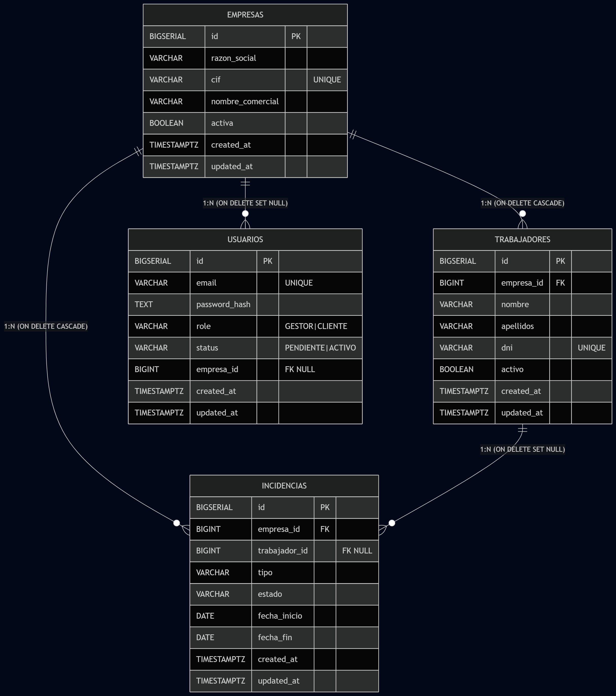
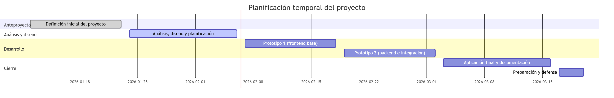

# Anteproyecto

## Aplicación de asesoramiento laboral

**Autor:** David Docampo
**Ciclo:** DAW — FCT/Proxecto (2025–2026)
**Centro:** IES San Clemente
**Fecha:** 23/01/2026

## Índice

- [Aplicación de asesoramiento laboral](#aplicación-de-asesoramiento-laboral)
- [Índice](#índice)
- [Estado de arte o análisis del contexto](#estado-de-arte-o-análisis-del-contexto)
- [Propósito](#propósito)
- [Objetivos](#objetivos)
- [Alcance](#alcance)
  - [Funcionalidades incluidas](#funcionalidades-incluidas)
  - [Usuarios y perfiles](#usuarios-y-perfiles)
  - [Contexto de aplicación](#contexto-de-aplicación)
  - [Exclusiones y límites](#exclusiones-y-límites)
  - [Posibles mejoras futuras](#posibles-mejoras-futuras)
- [Análisis](#análisis)
  - [Análisis del problema](#análisis-del-problema)
  - [Descripción del proyecto](#descripción-del-proyecto)
  - [Objetivos](#objetivos-1)
  - [Alcance](#alcance-1)
  - [Justificación del proyecto y estudio de necesidades](#justificación-del-proyecto-y-estudio-de-necesidades)
  - [Funcionalidades del proyecto y actores implicados](#funcionalidades-del-proyecto-y-actores-implicados)
  - [Tipos de usuarios](#tipos-de-usuarios)
  - [Modelo de negocio](#modelo-de-negocio)
  - [Normativa aplicable](#normativa-aplicable)
- [Diseño](#diseño)
  - [Mapa de navegación (rutas)](#mapa-de-navegación-rutas)
  - [Wireframe de la página principal (Home)](#wireframe-de-la-página-principal-home)
  - [Wireframe del Dashboard (/app)](#wireframe-del-dashboard-app)
  - [Wireframe de Empresas (/app/empresas)](#wireframe-de-empresas-appempresas)
  - [Wireframe de Incidencias (/app/incidencias)](#wireframe-de-incidencias-appincidencias)
  - [Wireframe de Perfil (/app/perfil)](#wireframe-de-perfil-appperfil)
  - [Diagrama de casos de uso](#diagrama-de-casos-de-uso)
  - [Modelo de datos (Diagrama E/R)](#modelo-de-datos-diagrama-er)
  - [Infraestructura y arquitectura técnica](#infraestructura-y-arquitectura-técnica)
    - [Componentes principales](#componentes-principales)
    - [Decisiones tecnológicas (justificación)](#decisiones-tecnológicas-justificación)
    - [Comunicación entre componentes](#comunicación-entre-componentes)
    - [Autenticación y autorización (nivel conceptual)](#autenticación-y-autorización-nivel-conceptual)
  - [Autenticación y autorización (implementación en Prototipo 2)](#autenticación-y-autorización-implementación-en-prototipo-2)
    - [Despliegue y ejecución en desarrollo (entorno local)](#despliegue-y-ejecución-en-desarrollo-entorno-local)
    - [Consideraciones de escalabilidad (conceptual)](#consideraciones-de-escalabilidad-conceptual)
- [Planificación](#planificación)
  - [Identificación de fases](#identificación-de-fases)
  - [Recursos (humanos y materiales)](#recursos-humanos-y-materiales)
  - [Infraestructura y entorno de desarrollo](#infraestructura-y-entorno-de-desarrollo)
    - [Componentes principales](#componentes-principales-1)
    - [Comunicación entre capas](#comunicación-entre-capas)
    - [Entorno local de desarrollo](#entorno-local-de-desarrollo)
    - [Estructura del repositorio (alto nivel)](#estructura-del-repositorio-alto-nivel)
  - [Planificación temporal (resumen)](#planificación-temporal-resumen)
  - [Estimación de esfuerzo y presupuesto](#estimación-de-esfuerzo-y-presupuesto)
    - [Estimación inicial por bloques](#estimación-inicial-por-bloques)
    - [Criterio de coste (orientativo)](#criterio-de-coste-orientativo)
    - [Seguimiento del esfuerzo (método)](#seguimiento-del-esfuerzo-método)
  - [Metodología de trabajo](#metodología-de-trabajo)
  - [Riesgos y mitigación](#riesgos-y-mitigación)
  - [Modelo de negocio](#modelo-de-negocio-1)
  - [Normativa: protección de datos, obrigas fiscais e laborais, prevención de riscos e posibles axudas ou subvencións](#normativa-protección-de-datos-obrigas-fiscais-e-laborais-prevención-de-riscos-e-posibles-axudas-ou-subvencións)
    - [Protección de datos](#protección-de-datos)
    - [Obrigacións fiscais e laborais](#obrigacións-fiscais-e-laborais)
    - [Prevención de riscos laborais](#prevención-de-riscos-laborais)
    - [Posibles axudas ou subvencións](#posibles-axudas-ou-subvencións)
- [Codificación y Pruebas](#codificación-y-pruebas)
  - [Prototipos realizados](#prototipos-realizados)
    - [Prototipo 1](#prototipo-1)
    - [Prototipo 2](#prototipo-2)
  - [Autenticación y seguridad (JWT + roles)](#autenticación-y-seguridad-jwt--roles)
  - [Endpoints /me (acotados al usuario)](#endpoints-me-acotados-al-usuario)
  - [Helper de llamadas a la API (`apiFetch`)](#helper-de-llamadas-a-la-api-apifetch)
  - [Evidencias de pruebas (Thunder Client o similar)](#evidencias-de-pruebas-thunder-client-o-similar)
- [Referencias y recursos externos](#referencias-y-recursos-externos)
  - [Documentación oficial](#documentación-oficial)
  - [Recursos conceptuales](#recursos-conceptuales)
  - [Bibliografía](#bibliografía)

## Estado de arte o análisis del contexto

La aplicación está dirigida principalmente al ámbito del **asesoramiento laboral**, un sector que presta servicios, especialmente, a pequeñas y medianas empresas, así como a autónomos y profesionales que necesitan cumplir con sus obligaciones laborales y de seguridad social. Este tipo de asesorías gestionan habitualmente un volumen elevado de información relacionada con trabajadores, contratos, incidencias laborales y comunicaciones con distintos organismos públicos.

En muchos casos, la gestión de esta información se realiza mediante herramientas genéricas como hojas de cálculo, documentos de texto o aplicaciones no especializadas, lo que puede provocar errores, duplicidad de datos y dificultades en el seguimiento de los distintos procesos laborales. Esta situación se agrava especialmente en asesorías con múltiples clientes o empresas que gestionan plantillas con cierta rotación de personal.

La necesidad principal que se pretende cubrir con este proyecto es la **organización y centralización de la información laboral**, facilitando al asesor una visión clara del estado de cada empresa y de cada trabajador. Disponer de un sistema que permita registrar y consultar de forma estructurada los distintos procesos laborales (altas, bajas, variaciones de datos, vacaciones, incapacidades, etc.) contribuye a mejorar el control del trabajo diario y a reducir errores derivados de una gestión manual.

Existen actualmente aplicaciones comerciales orientadas a la gestión laboral y de recursos humanos, muchas de ellas integradas con sistemas oficiales o con funcionalidades avanzadas. Sin embargo, estas soluciones suelen resultar complejas, costosas o excesivamente amplias para pequeñas asesorías o empresas que solo necesitan un control básico y organizado de la información. Además, en un entorno académico, el acceso a estas herramientas no siempre es viable para fines de aprendizaje o demostración.

El desarrollo de esta aplicación abre una **oportunidad de mejora en la digitalización de la gestión laboral**, especialmente como herramienta de apoyo al trabajo del asesor. Aunque el proyecto no tiene como objetivo su comercialización directa, sí muestra cómo una solución web sencilla y bien estructurada puede aportar valor al sector, sirviendo como base para futuras ampliaciones o adaptaciones a entornos profesionales reales.

## Propósito

El propósito de este proyecto es el diseño y desarrollo de una **aplicación web de gestión orientada al asesoramiento laboral**, dirigida principalmente a pequeñas y medianas empresas, autónomos y asesorías laborales que necesiten organizar y controlar la información relacionada con la gestión de personal y sus obligaciones laborales.

La aplicación no tiene como objetivo realizar directamente trámites oficiales ante organismos públicos como la Seguridad Social, la Agencia Tributaria o el SEPE, sino **servir como una herramienta de apoyo al trabajo del asesor laboral**. Su función principal será facilitar la organización de la información, el seguimiento de procesos y la planificación de actuaciones laborales, ayudando al profesional a tomar decisiones con mayor control y seguridad. De este modo, la aplicación aporta valor al asesor laboral, al facilitar una visión clara y estructurada del estado de cada cliente y de sus obligaciones laborales, mejorando la eficiencia del servicio ofrecido.

El proyecto surge de la necesidad real de muchas asesorías y empresas de **centralizar la información laboral**, reducir errores derivados de la gestión manual y mejorar el seguimiento de actuaciones como altas y bajas de trabajadores, variaciones de datos, vacaciones, incapacidades u otras incidencias habituales. La aplicación permitirá registrar empresas, clientes y trabajadores, asociando a cada uno los distintos procesos laborales y su estado.

Este proyecto se plantea como una **aplicación funcional de demostración**, desarrollada en un entorno académico, que sirve como ejemplo de cómo una aplicación web puede aportar valor en el ámbito del asesoramiento laboral mediante la digitalización y organización de la información. La posible ampliación hacia funcionalidades más avanzadas, como la ejecución automática de trámites o la integración con plataformas oficiales, se considera una **línea de evolución futura**, fuera del alcance del presente proyecto.

En definitiva, el propósito del proyecto es crear una base sólida y estructurada que muestre de forma práctica cómo la tecnología puede apoyar el trabajo de una asesoría laboral, mejorando la organización, el control de la información y la eficiencia del servicio, dentro de unos límites realistas y acordes al contexto académico del desarrollo.

## Objetivos

El objetivo principal de este proyecto es desarrollar una aplicación web que sirva como herramienta de apoyo al asesoramiento laboral, permitiendo organizar y gestionar de forma estructurada la información relacionada con empresas, clientes y trabajadores, dentro de un entorno académico.

A partir de este objetivo general, se definen los siguientes objetivos específicos:

- Analizar las necesidades básicas de una asesoría laboral en relación con la gestión de información de trabajadores, empresas y procesos laborales habituales.

- Diseñar la estructura funcional de la aplicación, definiendo los distintos módulos y secciones necesarios para cubrir dichas necesidades (gestión de empresas, trabajadores, incidencias laborales, etc.).

- Desarrollar una interfaz web clara e intuitiva, orientada a facilitar el acceso y la consulta de la información laboral por parte del usuario.

- Implementar un prototipo funcional de la aplicación que permita registrar, visualizar y organizar información laboral mediante datos de prueba.

- Aplicar una arquitectura de aplicación web moderna, separando la lógica de presentación y la gestión de datos, siguiendo buenas prácticas de desarrollo.

- Documentar el proceso de análisis, diseño y desarrollo del proyecto, explicando las decisiones tomadas y justificando las soluciones adoptadas.

- Adquirir y consolidar conocimientos prácticos sobre el desarrollo de aplicaciones web, especialmente en el uso de tecnologías actuales y metodologías de trabajo orientadas a proyectos.

Estos objetivos servirán como referencia para guiar el desarrollo del proyecto y para evaluar el grado de cumplimiento del mismo en las distintas fases establecidas.

## Alcance

El proyecto se plantea como un **Producto Mínimo Viable (MVP)**, centrado en ofrecer un conjunto reducido pero funcional de características que permitan demostrar la viabilidad técnica y organizativa de la solución.

El alcance de este proyecto comprende el diseño y desarrollo de una **aplicación web de apoyo al asesoramiento laboral**, orientada a la **organización, registro y seguimiento interno de información** relacionada con empresas/clientes y sus trabajadores.

### Funcionalidades incluidas

La aplicación permitirá, como mínimo:

- **Gestión de empresas/clientes**, incluyendo el registro, listado y consulta de información básica.
- **Gestión de trabajadores** asociados a una empresa/cliente, permitiendo su registro, consulta y relación con incidencias laborales.
- **Registro y seguimiento de incidencias o expedientes laborales**, entendidos como **anotaciones internas de control**, que incluirán:
  - tipo de incidencia (altas, bajas, variaciones de datos, vacaciones, incapacidades, etc.),
  - fecha,
  - estado (pendiente, en curso, resuelta),
  - observaciones.

Estas incidencias no implican la realización de trámites oficiales, sino que representan **información orientativa y de seguimiento**, utilizada por el asesor para planificar actuaciones, realizar comprobaciones o preparar futuras gestiones administrativas fuera de la aplicación.

- **Navegación tipo SPA**, con páginas estructuradas para facilitar el acceso a la información.
- Interfaz web clara e intuitiva, orientada a facilitar el trabajo diario del asesor.

### Usuarios y perfiles

La aplicación contempla tres perfiles de acceso:

- **Usuario público**: acceso a páginas informativas (inicio, quiénes somos, contacto). No requiere autenticación.
- **Cliente registrado** (empresa o autónomo): acceso a la zona privada (`/app`) para **consulta** de la información asociada a su cuenta (empresas, trabajadores e incidencias vinculadas).
- **Administrador**: acceso a la zona privada con permisos de **gestión** (alta/edición/borrado) sobre empresas, trabajadores e incidencias, y administración básica de usuarios.

En esta fase se implementará un control de acceso **básico por roles** (cliente / administrador). Un sistema de permisos más detallado, con mayor control sobre las acciones de cada usuario, se deja como una posible mejora futura.

### Contexto de aplicación

El proyecto se desarrolla en un **entorno académico** y se entrega como un **prototipo funcional**, utilizando datos de prueba. Su objetivo es demostrar la viabilidad organizativa y funcional de una herramienta de este tipo, no ofrecer una solución lista para producción.

La aplicación será una **web responsive (mobile-first)**, accesible desde navegadores actuales, sin desarrollo de aplicaciones móviles nativas.

### Exclusiones y límites

Queda fuera del alcance del proyecto:

- La realización de **trámites oficiales reales** ante organismos públicos (Seguridad Social, Agencia Tributaria, SEPE).
- La integración con plataformas oficiales, certificados digitales o firma electrónica.
- Automatizaciones administrativas reales.
- Seguridad avanzada (autenticación multifactor, firma digital, cifrado certificado).
- Implantación en un entorno productivo real.

### Posibles mejoras futuras

Como líneas de evolución futura, no incluidas en el alcance por limitaciones de tiempo y recursos, se plantean:

- Integración con servicios oficiales.
- Gestión avanzada de roles y permisos.
- Sección de recursos oficiales (Estatuto de los Trabajadores actualizado, convenios colectivos).
- Acceso guiado a calendarios laborales por provincia y convenio.

## Análisis

El análisis del proyecto tiene como objetivo identificar y definir de forma clara las necesidades que debe cubrir la aplicación, los perfiles de usuario implicados y los requisitos que el sistema debe cumplir. Este apartado sirve como base para las fases posteriores de diseño y desarrollo, asegurando que la solución propuesta responde de manera coherente al problema planteado.

### Análisis del problema

En el ámbito del asesoramiento laboral, una parte importante del trabajo diario consiste en manejar información relacionada con empresas, trabajadores y distintos procesos o incidencias laborales. En muchos casos, esa información está repartida entre documentos, hojas de cálculo y notas internas, lo que complica su consulta, su actualización y el seguimiento de tareas.

Cuando no existe un sistema centralizado, es fácil que aparezcan duplicidades, errores al copiar datos y pérdidas de tiempo buscando la información más actualizada o comprobando el estado de una incidencia. Estos problemas se acentúan especialmente cuando se gestionan varios clientes o cuando existen cambios frecuentes en las plantillas de trabajadores.

Especialmente en el caso de pequeñas empresas y autónomos, la gestión de las obligaciones laborales supone una carga significativa. En muchos casos, asumir internamente estas tareas implicaría la contratación de personal específico, a menudo a tiempo completo, lo que resulta inviable desde un punto de vista económico. Además, delegar estas funciones en personas sin la formación adecuada conlleva un riesgo elevado, ya que errores en materia laboral pueden derivar en sanciones, recargos o costes económicos importantes para la empresa.

Con este proyecto no se pretende automatizar trámites oficiales, sino **mejorar la organización y el control interno de la información laboral**. La idea es que el asesor laboral pueda disponer de una visión clara y estructurada de cada empresa y de sus trabajadores, así como llevar un seguimiento sencillo de incidencias habituales (altas, bajas, vacaciones, situaciones de incapacidad temporal, variaciones de datos, etc.), indicando su estado y observaciones.

### Descripción del proyecto

El proyecto consiste en el diseño y desarrollo de una **aplicación web de apoyo al asesoramiento laboral**, orientada a la organización y gestión interna de la información relacionada con empresas, clientes y trabajadores. La aplicación permitirá centralizar datos y realizar un seguimiento estructurado de los distintos procesos e incidencias laborales habituales, con el objetivo de mejorar el control y la eficiencia del trabajo diario del asesor.

Se trata de un proyecto desarrollado en un **entorno académico**, planteado como un **prototipo funcional**, que utiliza datos de prueba y no realiza trámites oficiales reales. La aplicación está concebida como una herramienta de apoyo organizativo, no como un sustituto de las plataformas oficiales de las administraciones públicas.

### Objetivos

El objetivo principal del proyecto es desarrollar una aplicación web que sirva como herramienta de apoyo al asesoramiento laboral, facilitando la organización y consulta de la información laboral de empresas y trabajadores.

Este objetivo general se concreta en los siguientes aspectos, ya definidos en el anteproyecto y ampliados conforme avanza el desarrollo técnico del proyecto:

- Analizar las necesidades básicas de una asesoría laboral en relación con la gestión y organización de la información.

- Diseñar una estructura funcional clara y coherente, diferenciando zonas públicas y privadas dentro de una arquitectura SPA.

- Implementar un prototipo funcional en el frontend utilizando **React**, aplicando el modelo de componentes y una estructura modular que facilite la escalabilidad y el mantenimiento del código.

- Configurar el sistema de navegación mediante **React Router**, estableciendo rutas públicas y privadas, así como validando el flujo de acceso a la aplicación.

- Aplicar un framework de estilos como **Tailwind CSS** para la maquetación de la interfaz, garantizando coherencia visual, diseño responsive y reutilización de componentes.

- Simular un sistema de autenticación en el frontend con el fin de validar la arquitectura de acceso a la zona privada, dejando preparada la aplicación para su futura integración con un sistema real basado en tokens.

- Implementar en fases posteriores un backend con **Node.js y Express**, exponiendo una API REST para la gestión de empresas, trabajadores e incidencias.

- Incorporar autenticación basada en **JSON Web Tokens (JWT)** en fases posteriores, integrando el frontend con el backend y protegiendo los recursos privados de la aplicación.

- Diseñar e implementar la persistencia de datos mediante **PostgreSQL**, trasladando el modelo conceptual a un esquema relacional y realizando operaciones CRUD desde la API.

- Aplicar buenas prácticas de desarrollo, control de versiones y documentación técnica, manteniendo coherencia entre el código implementado y la memoria del proyecto.

Los objetivos servirán como referencia para evaluar el grado de cumplimiento del proyecto a lo largo de las distintas fases de análisis, diseño y desarrollo, permitiendo verificar que la evolución técnica del sistema se ajusta al alcance definido.

### Alcance

El alcance del proyecto incluye el diseño y desarrollo de una aplicación web que permita la **gestión interna de información laboral**, como empresas, trabajadores e incidencias asociadas, mediante una interfaz web accesible desde navegadores actuales.

Quedan dentro del alcance la organización, registro y seguimiento de datos de forma orientativa, así como la navegación tipo SPA y una interfaz clara e intuitiva. Quedan expresamente fuera del alcance la realización de trámites oficiales, la integración con plataformas públicas, la automatización administrativa real y la implantación en un entorno productivo, tal y como se detalla en el apartado de alcance del anteproyecto.

### Justificación del proyecto y estudio de necesidades

Las pequeñas y medianas empresas, así como muchos trabajadores autónomos, necesitan cumplir con un conjunto de obligaciones laborales y administrativas que requieren conocimientos específicos y una atención constante. En muchos casos, asumir internamente estas tareas supondría contratar personal especializado, habitualmente a tiempo completo, lo que resulta **inviable desde el punto de vista económico** para gran parte de estas organizaciones.

Por este motivo, la externalización de la gestión laboral a través de asesorías especializadas es una práctica habitual. No obstante, incluso dentro de las propias asesorías, gran parte del trabajo diario se apoya en herramientas genéricas o en procedimientos manuales que no siempre facilitan una visión clara del estado de cada cliente o de cada incidencia laboral.

Este proyecto se justifica como una respuesta a la necesidad de **organizar, centralizar y estructurar la información laboral**, reduciendo el riesgo de errores, mejorando el seguimiento de tareas y aportando mayor seguridad en la gestión interna. Disponer de una herramienta específica de apoyo permite al asesor dedicar más tiempo al análisis y a la toma de decisiones, minimizando los problemas derivados de una gestión dispersa o poco sistematizada.

### Funcionalidades del proyecto y actores implicados

La aplicación se concibe como una herramienta de apoyo al asesoramiento laboral, centrada en la gestión interna de la información. Las principales funcionalidades previstas son:

- Registro y gestión de empresas o clientes.
- Registro y gestión de trabajadores asociados a cada empresa.
- Creación y seguimiento de incidencias o expedientes laborales, tales como altas, bajas, variaciones de datos, vacaciones o situaciones de incapacidad, tratadas como anotaciones internas de control.
- Consulta del estado de las incidencias y registro de observaciones asociadas a cada una.
- Acceso a información organizada mediante una navegación clara y estructurada.

Los actores que intervienen en estas funcionalidades son:

- El **asesor laboral**, como principal usuario del sistema.
- El **cliente (empresa o autónomo)**, en caso de habilitarse un acceso limitado a la consulta de su información.
- Usuarios no autenticados, en el caso de las secciones informativas públicas de la aplicación.

### Tipos de usuarios

El sistema contempla tres roles de usuario claramente diferenciados:

- **Usuario público**: acceso sin autenticación a las páginas informativas.
- **Usuario cliente**: usuario autenticado con acceso de solo consulta a la información asociada a su empresa.
- **Usuario administrador**: usuario autenticado con permisos completos de gestión sobre empresas, trabajadores e incidencias.

La autorización se plantea de forma sencilla, basada en el rol asociado al token de autenticación, evitando un sistema de permisos excesivamente complejo fuera del alcance del proyecto.

### Modelo de negocio

El proyecto se desarrolla en un **entorno académico** y no tiene como objetivo su comercialización directa. No obstante, el modelo planteado es compatible con una posible evolución hacia un producto orientado a asesorías laborales, bajo un esquema de:

- Suscripción mensual por asesoría.
- Licencias por número de clientes o trabajadores gestionados.
- Uso como herramienta interna personalizada para despachos profesionales.

Este planteamiento se incluye a nivel conceptual, sin desarrollo técnico ni comercial en la presente fase del proyecto.

### Normativa aplicable

Aunque la aplicación no realiza trámites oficiales ni gestiona datos reales en producción, el proyecto tiene en cuenta, a nivel conceptual, la normativa relacionada con el ámbito laboral y la protección de datos, entre la que se incluyen:

- **Protección de datos personales** (RGPD y LOPDGDD), especialmente en lo relativo al tratamiento de datos de trabajadores y empresas.
- **Normativa laboral básica**, como el Estatuto de los Trabajadores y los convenios colectivos.
- **Obligaciones fiscales y laborales**, en cuanto a la correcta gestión y conservación de la información.
- **Prevención de riesgos laborales**, considerada como parte del contexto general del asesoramiento laboral.

Estas normativas se contemplan como marco de referencia, sin implementación técnica específica en esta fase académica.

## Diseño

### Mapa de navegación (rutas)

A continuación se muestra el mapa de navegación de la aplicación, que representa de forma visual las rutas públicas y privadas, así como la jerarquía de acceso entre las distintas secciones. Este diagrama ha sido elaborado utilizando Mermaid y exportado como imagen para su inclusión en la documentación.

### Wireframe de la página principal (Home)

A continuación se presenta el wireframe de la página principal de la aplicación.  
Este esquema define la estructura general de la Home, las secciones principales y los puntos de interacción del usuario, sirviendo como guía para el diseño visual y la implementación posterior.

### Wireframe del Dashboard (/app)

El dashboard constituye la **pantalla principal de la aplicación tras la autenticación del usuario**. El acceso a esta área está reservado a usuarios con cuenta, que representan a **clientes (empresas o autónomos) y/o a la asesoría**, y que ya tienen servicios asociados dentro de la aplicación.

Su objetivo es ofrecer una **visión personalizada y resumida** de la información laboral relacionada con el usuario autenticado, mostrando únicamente los datos que le afectan directamente, como sus empresas, trabajadores, incidencias o estados de seguimiento. De este modo, el usuario puede consultar de forma rápida qué servicios tiene activos, el estado de sus gestiones y acceder a las principales funcionalidades sin necesidad de navegar por múltiples secciones.

El dashboard actúa, por tanto, como un **punto central de acceso** a la aplicación, facilitando la organización del trabajo diario y mejorando la experiencia de uso mediante información clara, contextualizada y accesos rápidos a las acciones más habituales.

### Wireframe de Empresas (/app/empresas)

La vista de empresas permite al usuario autenticado gestionar las empresas o clientes asociados a su cuenta, consultar información relevante y acceder a funcionalidades relacionadas como trabajadores e incidencias.

### Wireframe de Incidencias (/app/incidencias)

La vista de incidencias permite al usuario autenticado registrar y dar seguimiento a eventos o procesos laborales (altas, bajas, vacaciones, IT, variaciones de datos, etc.) como anotaciones internas de control. Incluye filtros para localizar rápidamente incidencias por empresa, trabajador, tipo, estado o fechas, y un listado con acciones frecuentes.

### Wireframe de Perfil (/app/perfil)

La pantalla de perfil centraliza la información básica de la cuenta autenticada y acciones habituales como actualizar preferencias y gestionar seguridad (por ejemplo, cambio de contraseña y cierre de sesión). En el contexto académico, se añade un bloque de avisos sobre uso de datos de prueba.

### Diagrama de casos de uso

El siguiente diagrama de casos de uso muestra las principales interacciones entre los distintos tipos de usuario y las funcionalidades clave del sistema.

### Modelo de datos (Diagrama E/R)

El modelo relacional se organiza en torno a la entidad **Empresas** y sus relaciones con **Trabajadores** e **Incidencias**.  
En este prototipo se añade la entidad **Usuarios** para soportar autenticación y roles, vinculada opcionalmente a una empresa (según el tipo de usuario).

**Notas de integridad referencial:**

- `trabajadores.empresa_id` e `incidencias.empresa_id` usan borrado en cascada para eliminar registros dependientes cuando se elimina una empresa.
- `incidencias.trabajador_id` y `usuarios.empresa_id` usan `ON DELETE SET NULL` para conservar el registro (incidencia/usuario) aunque desaparezca el trabajador o la empresa asociada.
- `usuarios.email` se define como único para evitar duplicados y los campos `role/status` se validan mediante restricciones (CHECK).

### Infraestructura y arquitectura técnica

La aplicación se plantea con una arquitectura web en tres capas, separando la interfaz de usuario, la lógica de negocio y la persistencia de datos. Esta separación facilita el mantenimiento, permite desarrollar cada parte de forma incremental y reduce el acoplamiento entre componentes.

#### Componentes principales

- **Frontend (SPA)**  
  Aplicación cliente desarrollada con **React + Vite**, accesible desde navegador.  
  Se encarga de la navegación, renderizado de vistas y validaciones básicas de formularios.
  En el área privada (`/app`), se ha implementado una estructura basada en un layout específico que incluye cabecera y menú lateral de navegación. Este enfoque permite organizar las distintas secciones internas (dashboard, empresas, trabajadores e incidencias) manteniendo coherencia visual y facilitando la escalabilidad futura del sistema.

- **Backend (API REST)**  
  Servicio desarrollado con **Node.js + Express** que expone endpoints HTTP para gestionar los datos (empresas, trabajadores, incidencias, etc.).  
  Centraliza la lógica de negocio y valida las peticiones del cliente.

- **Base de datos (PostgreSQL)**  
  Sistema de persistencia relacional para almacenar la información del dominio (clientes/empresas, trabajadores, incidencias y usuarios).  
  El backend accede a la base de datos mediante un cliente PostgreSQL (p. ej. `pg`) y consultas parametrizadas.

#### Decisiones tecnológicas (justificación)

- La aplicación se ha planteado con una arquitectura **SPA + API REST + base de datos relacional**. Esta separación permite desarrollar por módulos, validar el sistema por prototipos y mantener desacopladas la interfaz, la lógica de servidor y la persistencia.

- **React + Vite (frontend):**
  Se ha elegido React para construir una SPA basada en componentes reutilizables y un estado controlado desde la interfaz. Frente a alternativas más “tradicionales” (páginas renderizadas en servidor o HTML/JS sin estructura), React facilita organizar la UI por vistas y componentes, y mantener un flujo claro de datos y renderizado.
  Vite se utiliza como entorno de desarrollo por su rapidez durante la implementación (arranque y recarga), lo que reduce tiempo de iteración en un proyecto académico con entregas por prototipos.
  Además, a nivel formativo, React es una tecnología con presencia real en el mercado, por lo que su uso aporta valor en términos de empleabilidad y dominio de herramientas actuales.

- **Node.js + Express (backend):**
  Se ha optado por Node.js con Express para construir la API REST de forma ligera y modular. Express es un framework minimalista que permite definir rutas y middlewares con una curva de aprendizaje asumible y sin imponer demasiada estructura.
  En este proyecto encaja bien porque el objetivo es exponer endpoints claros en JSON, mantener una separación por capas (routes/controllers/services) y evolucionar el backend conforme crecen las entidades del dominio (empresas, trabajadores, incidencias).

- **PostgreSQL + pg (persistencia):**
  Se ha elegido PostgreSQL por su enfoque relacional y por la facilidad para modelar el dominio con integridad (claves primarias, restricciones y claves foráneas). Frente a soluciones no relacionales, permite representar relaciones entre empresas, trabajadores e incidencias de forma consistente.
  El backend accede mediante `pg` y un `Pool` de conexiones, centralizando la configuración y reutilizando conexiones para mejorar la eficiencia en ejecución local.

- **Tailwind CSS (estilos):**
  Se utiliza Tailwind CSS para mantener coherencia visual y reducir CSS específico mediante clases utilitarias. Facilita aplicar diseño responsive con sus breakpoints (`sm`, `md`, `lg`, etc.) sin necesidad de escribir media queries manuales en la mayoría de casos.
  A nivel formativo, su uso también se justifica por su adopción actual en muchos proyectos y por la rapidez para prototipar interfaces manteniendo consistencia.

#### Comunicación entre componentes

- El frontend se comunica con el backend mediante **peticiones HTTP** (GET, POST, PUT/PATCH, DELETE).
- El formato de intercambio de datos es **JSON**.
- La API devolverá códigos de estado HTTP adecuados (200, 201, 400, 401, 404, 500, etc.) y mensajes de error controlados.

#### Autenticación y autorización (nivel conceptual)

La zona privada de la aplicación (`/app`) estará accesible únicamente para usuarios autenticados. A nivel de diseño, se plantea un modelo sin estado basado en el uso de **tokens**, como **JWT**, que permita identificar al usuario en cada petición a la API.

De forma general, el funcionamiento previsto es el siguiente:

- El usuario inicia sesión y el backend genera un token.
- El frontend envía ese token en cada petición a la API.
- El backend valida el token y permite o deniega el acceso a los datos correspondientes.

En esta fase del proyecto, este planteamiento se recoge a nivel conceptual y se irá implementando de manera progresiva en los siguientes prototipos.

En el frontend se ha implementado un componente `ProtectedRoute` que controla el acceso a la zona privada de la aplicación. Actualmente, la autenticación se simula mediante una condición booleana, con el objetivo de comprobar el funcionamiento de la navegación y la separación entre rutas públicas y privadas.

Este enfoque permite avanzar en el desarrollo y validar la estructura de la aplicación sin introducir todavía un sistema completo de autenticación. En fases posteriores, esta lógica se sustituirá por un sistema real basado en JWT, integrado con el backend.

### Autenticación y autorización (implementación en Prototipo 2)

En el Prototipo 2 se ha incorporado un sistema de autenticación basado en credenciales y tokens JWT para controlar el acceso a operaciones sensibles de la API.

Para ello se añade la tabla **usuarios** (con email único, hash de contraseña y rol), y se definen middlewares de seguridad para:

- Verificar la identidad del usuario mediante token (autenticación).
- Restringir acciones según el rol (autorización), por ejemplo operaciones reservadas a GESTOR.

#### Despliegue y ejecución en desarrollo (entorno local)

Durante el desarrollo, los componentes se ejecutarán en local:

- Frontend: servidor de desarrollo de Vite (p. ej. `http://localhost:5173`)
- Backend: servidor Express (p. ej. `http://localhost:3000`)
- Base de datos: PostgreSQL local

La configuración de URLs y variables sensibles (por ejemplo, credenciales o secretos) se gestionará mediante variables de entorno.

#### Consideraciones de escalabilidad (conceptual)

Aunque el proyecto es académico, la arquitectura propuesta permite escalar de forma razonable:

- El **frontend** puede servirse como contenido estático.
- El **backend**, al ser stateless con token, podría ejecutarse en varias instancias detrás de un balanceador.
- La **base de datos** puede mejorar rendimiento mediante índices y optimización de consultas en los campos más utilizados.

## Planificación

La planificación del proyecto se ha realizado teniendo en cuenta el calendario oficial de entregas establecido en el aula virtual (Mestre), así como la duración total del proyecto, que abarca desde el 12 de enero de 2026 hasta el 16 de marzo de 2026, con presentación final el 20 de marzo de 2026.

El proyecto se estructura en fases progresivas que permiten validar resultados parciales en cada entrega, facilitando el seguimiento por parte del tutor y reduciendo los riesgos derivados del desarrollo.

### Identificación de fases

El desarrollo del proyecto se divide en las siguientes fases:

1. **Anteproyecto**
   - Definición inicial de la idea del proyecto.
   - Planteamiento general del problema y de la solución propuesta.
   - Entrega realizada el **23/01/2026**.

2. **Análisis, diseño y planificación**
   - Definición de requisitos y funcionalidades del sistema.
   - Identificación de actores y casos de uso.
   - Diseño del mapa de navegación, wireframes y modelo de datos (E-R).
   - Planificación técnica y temporal del proyecto.
   - **Entrega prevista: 06/02/2026**.

3. **Prototipo 1**
   - Preparación y validación del entorno de desarrollo.
   - Implementación inicial del frontend (estructura base, rutas y componentes principales).
   - Desarrollo de un primer prototipo funcional con navegación básica.
   - **Entrega prevista: 18/02/2026**.

4. **Prototipo 2**
   - Desarrollo del backend mediante una API REST.
   - Integración entre frontend y backend.
   - Implementación de las funcionalidades principales (operaciones CRUD).
   - **Entrega prevista: 02/03/2026**.

5. **Aplicación final y documentación**
   - Finalización de funcionalidades pendientes.
   - Pruebas, corrección de errores y mejoras de usabilidad.
   - Elaboración y revisión de la documentación técnica y funcional.
   - **Entrega final: 16/03/2026**.

6. **Preparación y presentación del proyecto**
   - Elaboración de la presentación final.
   - Preparación de la defensa y ensayos previos.
   - Entrega de la presentación: **19/03/2026**.
   - Exposición oral del proyecto: **20/03/2026**.

### Recursos (humanos y materiales)

**Recursos humanos**

- Un único desarrollador: **David Docampo Trabazo**, responsable del análisis, diseño, implementación, pruebas, documentación y defensa del proyecto.

**Recursos materiales y software**

- Equipo personal con sistema operativo Windows 11.
- Visual Studio Code como entorno de desarrollo.
- Control de versiones mediante Git y GitLab.
- Frontend desarrollado con React y Vite.
- Backend basado en Node.js y Express.
- Base de datos PostgreSQL.
- Herramientas de documentación y diagramado: Markdown y Mermaid.

### Infraestructura y entorno de desarrollo

La aplicación se desarrollará siguiendo una arquitectura web de tres capas, separando claramente la interfaz de usuario, la lógica de negocio y la persistencia de datos. Este enfoque facilita el desarrollo incremental, el mantenimiento del código y la validación progresiva de resultados en cada entrega.

#### Componentes principales

- **Frontend (SPA)**  
  Aplicación web desarrollada con **React y Vite**, responsable de la interfaz de usuario, la navegación y la interacción con el sistema. Se implementa como una _Single Page Application_ (SPA).

  En el frontend se ha optado por una separación explícita entre rutas públicas y privadas mediante layouts diferenciados (`PublicLayout` y `PrivateLayout`). Esta estructura permite encapsular la zona privada bajo la ruta `/app`, facilitando la escalabilidad de la aplicación y dejando preparada la integración de mecanismos de protección de rutas y control de sesión de forma centralizada, acorde al enfoque incremental del proyecto.

- **Backend (API REST)**  
  Servidor desarrollado con **Node.js y Express**, encargado de exponer una API REST para la gestión de datos (operaciones CRUD), aplicar validaciones y centralizar la lógica básica de negocio.

- **Base de datos**  
  **PostgreSQL**, utilizada para almacenar la información persistente del sistema, como empresas o clientes, trabajadores e incidencias laborales.

#### Comunicación entre capas

- El frontend consume la API del backend mediante peticiones HTTP (GET, POST, PUT, DELETE).
- El backend procesa las peticiones, interactúa con la base de datos y devuelve respuestas en formato JSON.
- Durante las fases iniciales del proyecto, algunas vistas del frontend pueden trabajar con datos simulados, hasta completar la integración con la base de datos real.

#### Entorno local de desarrollo

El proyecto se ejecuta en un entorno local de desarrollo, lo que permite iterar rápidamente y detectar errores de forma temprana:

- **Frontend**: ejecución mediante `npm run dev` (Vite), accesible desde el navegador en `http://localhost:<puerto>`.
- **Backend**: ejecución mediante Node.js y Express en un puerto independiente (por ejemplo, `http://localhost:3000`), con configuración de CORS para permitir la comunicación con el frontend.
- **Base de datos**: instancia local de PostgreSQL con una base de datos específica para desarrollo y datos de prueba.

#### Estructura del repositorio (alto nivel)

- `frontend/`: aplicación React (Vite), componentes, vistas y rutas.
- `backend/` (previsto): API REST desarrollada con Express.
- `doc/`: documentación del proyecto y diagramas.

### Planificación temporal (resumen)

| Fase                             | Periodo aproximado      |
| -------------------------------- | ----------------------- |
| Anteproyecto                     | 12/01/2026 – 23/01/2026 |
| Análisis, diseño y planificación | 24/01/2026 – 06/02/2026 |
| Prototipo 1                      | 07/02/2026 – 18/02/2026 |
| Prototipo 2                      | 19/02/2026 – 02/03/2026 |
| Aplicación final y documentación | 03/03/2026 – 16/03/2026 |
| Presentación                     | 17/03/2026 – 20/03/2026 |

A continuación se muestra un diagrama de Gantt que representa de forma visual la planificación temporal del proyecto por fases, alineada con el calendario oficial de entregas.

### Estimación de esfuerzo y presupuesto

La estimación de esfuerzo se ha realizado desglosando el trabajo por bloques principales (documentación, frontend, backend, base de datos, integración y pruebas). Esta estimación se irá ajustando en las siguientes entregas, registrando desviaciones y decisiones (por ejemplo, mediante issues y anotaciones de seguimiento).

#### Estimación inicial por bloques

| Bloque de trabajo                               | Horas estimadas |
| ----------------------------------------------- | --------------: |
| Documentación (análisis, diseño, planificación) |              45 |
| Frontend (UI, rutas, formularios, validaciones) |              65 |
| Backend (API REST, validaciones, JWT, CORS)     |              55 |
| Base de datos (modelo, creación, consultas)     |              25 |
| Integración FE/BE + gestión de errores          |              20 |
| Pruebas básicas y correcciones                  |              10 |
| Preparación de presentación y defensa           |              10 |
| **Total estimado**                              |         **230** |

> Nota: En las fases iniciales del proyecto, el frontend puede trabajar con datos de prueba para validar la interfaz y la navegación, sustituyéndose posteriormente por la integración real con el backend y la base de datos.

#### Criterio de coste (orientativo)

A efectos académicos, se realiza una estimación económica orientativa basada en horas de trabajo:

- Coste hora estimado: **20 € / hora**
- Coste total aproximado: **230 h × 20 € = 4.600 €**

Este cálculo tiene un carácter exclusivamente académico y sirve para contextualizar el esfuerzo del proyecto.

#### Seguimiento del esfuerzo (método)

Para registrar el avance y justificar desviaciones, el trabajo se organizará en **issues** en GitLab, etiquetadas por área (por ejemplo: `doc`, `frontend`, `backend`, `bd`, `bug`, `mejora-futura`). En cada issue se incluirá:

- estimación inicial (horas),
- tiempo dedicado aproximado,
- resultado (resuelto / pospuesto / mejora futura),
- y, si procede, referencias a commits relacionados.

### Metodología de trabajo

El proyecto se desarrolla siguiendo un enfoque incremental e iterativo, basado en:

- Avances progresivos con entregas parciales.
- Uso de control de versiones con commits frecuentes y descriptivos.
- Revisión continua de la documentación conforme evoluciona el desarrollo.
- Coordinación periódica con el tutor para validar decisiones técnicas y de alcance.

El **seguimiento del proyecto** se ha realizado mediante **issues** y un **tablero Kanban** en GitLab, utilizados para planificar tareas, visualizar el estado del trabajo y documentar mejoras futuras de forma estructurada.

### Riesgos y mitigación

Durante el desarrollo del proyecto se han identificado los siguientes riesgos potenciales:

- **Exceso de alcance funcional**  
  _Mitigación:_ delimitación clara del alcance y priorización de un prototipo funcional viable.

- **Problemas de integración entre frontend y backend**  
  _Mitigación:_ desarrollo incremental y pruebas tempranas de comunicación entre capas.

- **Limitaciones de tiempo**  
  _Mitigación:_ planificación basada en entregas parciales y ajuste continuo de objetivos.

- **Complejidad técnica superior a la prevista**  
  _Mitigación:_ uso de tecnologías conocidas y bien documentadas, evitando soluciones innecesariamente complejas.

La identificación de estos riesgos permite anticipar posibles problemas y reducir su impacto en el desarrollo global del proyecto.

### Modelo de negocio

El presente proyecto se enmarca en un contexto académico, por lo que no persigue la creación de una empresa propia ni la comercialización directa del software. No obstante, resulta necesario describir el modelo de uso y valor que tendría la aplicación en un entorno real.

La aplicación está pensada para ser utilizada por asesorías laborales pequeñas o medianas, así como por profesionales autónomos del ámbito laboral, como herramienta interna de apoyo a la gestión de la información. Su objetivo principal es centralizar y organizar datos relacionados con empresas clientes, trabajadores e incidencias laborales, facilitando su consulta y seguimiento.

Desde el punto de vista del modelo de negocio, el software podría implantarse como:

- una aplicación interna instalada en la propia infraestructura de la asesoría, o
- un servicio web de uso privado, accesible únicamente por personal autorizado.

El valor que aporta la aplicación no se basa en la automatización de trámites oficiales ni en la sustitución de plataformas de la Administración, sino en:

- la mejora de la organización interna,
- la reducción de información dispersa,
- y el apoyo al trabajo diario del personal de la asesoría.

El modelo económico asociado sería el habitual en este tipo de soluciones:

- pago por licencia,
- suscripción periódica,
- o desarrollo a medida para una asesoría concreta.

En el contexto de este proyecto, dicho modelo se describe únicamente a nivel conceptual, ya que la aplicación se desarrolla con datos de prueba y con fines formativos, sin explotación comercial real.

### Normativa: protección de datos, obrigas fiscais e laborais, prevención de riscos e posibles axudas ou subvencións

El desarrollo de esta aplicación se realiza en un **entorno académico** y con **datos de prueba**, por lo que no se gestionan datos reales de carácter personal ni se realizan trámites oficiales. Aun así, se han tenido en cuenta las principales normativas que afectarían a una aplicación de este tipo en un entorno real, a nivel conceptual y formativo.

#### Protección de datos

En un contexto real, la aplicación estaría sujeta al **Reglamento General de Protección de Datos** (RGPD) y a la **Ley Orgánica de Protección de Datos Personales y Garantía de los Derechos Digitales** (LOPDGDD), al tratar información relativa a personas trabajadoras.
En este proyecto:

- no se utilizan datos reales,
- no se realiza tratamiento efectivo de información personal,
- y la aplicación se limita a un entorno de pruebas.

No obstante, se han tenido en cuenta principios básicos como:

- control de acceso mediante autenticación,
- separación de roles de usuario,
- y restricción del acceso a la información según permisos.

#### Obrigacións fiscais e laborais

La aplicación no sustituye ni automatiza las obligaciones legales de la asesoría frente a organismos oficiales (Seguridad Social, SEPE, Agencia Tributaria, etc.). Su finalidad es únicamente organizativa, como apoyo interno a la gestión de la información laboral.

Cualquier cumplimiento normativo real seguiría dependiendo de los procedimientos y herramientas oficiales correspondientes.

#### Prevención de riscos laborais

En un entorno profesional real, el desarrollo y mantenimiento de software implica considerar aspectos relacionados con la **prevención de riesgos laborales**, especialmente en trabajos con pantallas de visualización de datos (PVD).

Entre estos aspectos destacan:

- la _ergonomía_ del puesto de trabajo (silla, mesa y postura),
- una _iluminación_ adecuada que reduzca la fatiga visual,
- _condiciones ambientales_ correctas (temperatura, ventilación y confort),
- y la correcta _organización_ del tiempo de trabajo, incluyendo pausas periódicas.

En el contexto de este proyecto académico no se implementan medidas específicas relacionadas con la prevención de riesgos laborales, pero se reconoce este marco como parte del entorno real en el que se desarrollaría y utilizaría una aplicación de este tipo.

#### Posibles axudas ou subvencións

En un escenario real, la adopción de una herramienta de digitalización como la desarrollada en este proyecto podría encajar en programas de apoyo orientados a la modernización y digitalización de pequeñas y medianas empresas.

De forma general, podrían existir:

- programas de digitalización de pymes,
- líneas de apoyo a la innovación tecnológica,
- o subvenciones destinadas a la transformación digital del tejido empresarial.

En el marco de este proyecto académico no se tramitan ni se analizan subvenciones concretas, mencionándose este apartado únicamente para contextualizar la viabilidad y el encaje teórico de una solución de este tipo en un entorno profesional real.

## Codificación y Pruebas

### Prototipos realizados

#### Prototipo 1

**Fecha:** 18 de febrero del 2026

**Descripción:**

El Prototipo 1 corresponde a la primera versión funcional de la aplicación web. En esta fase se ha desarrollado el frontend como una Single Page Application (SPA), estableciendo la estructura base del proyecto, el sistema de navegación y el control de acceso a la zona privada de la aplicación.

El objetivo principal de este prototipo es validar el flujo de navegación, la separación entre zonas públicas y privadas y el comportamiento básico de autenticación, sin disponer todavía de un backend ni de un sistema real de gestión de usuarios.

La autenticación se implementa de forma simulada en el frontend con fines académicos, permitiendo desarrollar y probar la arquitectura de la aplicación antes de incorporar mecanismos reales de seguridad en fases posteriores.

**Funcionalidades implementadas:**

- Desarrollo del frontend como SPA utilizando **React** y **Vite**.
- Configuración del enrutado de la aplicación mediante **React Router**.
- La navegación se gestiona de forma declarativa mediante **React Router**, definiendo las rutas y los componentes asociados sin manipular directamente el DOM.
- Separación de rutas públicas y privadas mediante layouts específicos (`PublicLayout` y `PrivateLayout`).
- Implementación de un componente `ProtectedRoute` para controlar el acceso a la zona privada de la aplicación.
- Gestión del estado de autenticación mediante **Context API**, con funciones `login()` y `logout()` simuladas, sin conexión a backend. El uso de **Context API** apermite gestionar el estado global sin necesidad de incorporar librerías externas como **Redux** en esta fase del proyecto.
- Uso de hooks de React como `useState`, `useEffect` y `useContext` para gestionar estado, efectos y autenticación simulada.
- Formularios de **login y registro** con validación básica en el frontend y redirección automática a la zona privada (`/app`) tras la autenticación simulada.
- Página **Dashboard** accesible únicamente para usuarios autenticados, con opción de cierre de sesión que devuelve al usuario a la página de login.
- Ampliación de la zona privada bajo la ruta `/app/*`, incorporando páginas internas de navegación (empresas, trabajadores e incidencias) como estructura base del área autenticada.
- Implementación de un layout privado con cabecera y menú lateral (sidebar), organizando la navegación interna y el contenido mediante `<Outlet />`.
- Navegación interna mediante enlaces con estado activo visible, facilitando la orientación del usuario dentro del sistema.
- Rediseño del **Header público**, incluyendo navegación contextual, versión responsive con menú móvil y comportamiento sticky para mejorar la usabilidad.
- Configuración de una paleta de colores personalizada en **Tailwind CSS**, centralizando estilos para garantizar coherencia visual y facilitar la escalabilidad futura.
- Creación de un componente reutilizable `Button` para unificar estilos y comportamiento, favoreciendo la mantenibilidad del código.
- Adaptación responsive del área privada: menú lateral visible en escritorio y colapsable en dispositivos móviles.
- Verificación del comportamiento responsive en dispositivo móvil real.

**Pruebas realizadas:**

Las pruebas realizadas en este prototipo han sido de tipo manual, centradas en validar el flujo de navegación y autenticación:

- Acceso directo a la ruta privada `/app` sin estar autenticado redirige correctamente a la página `/login`.
- El uso del login simulado permite acceder a la zona privada de la aplicación.
- El cierre de sesión (logout) invalida el estado de autenticación y redirige al usuario a la página de login.
- Los formularios de login y registro validan campos básicos antes de permitir el acceso.
- Comprobación del comportamiento responsive del layout privado en dispositivos móviles y escritorio.
- Verificación del resaltado automático del enlace activo en el menú lateral.

#### Prototipo 2

**Fecha:** 2 marzo de 2026

**Descripción:**

El Prototipo 2 introduce la capa servidor y la persistencia de datos. En esta fase se ha iniciado la implementación del backend como servicio independiente (API REST) con **Node.js y Express**, y se ha configurado una base de datos **PostgreSQL** local para almacenar la información del sistema.

El objetivo principal de este prototipo es validar la arquitectura cliente-servidor, la comunicación mediante JSON, la conexión real con la base de datos y la implementación inicial de operaciones CRUD sobre la primera entidad del dominio (empresas).

**Funcionalidades implementadas:**

- Creación y configuración del backend con **Express**, separado del frontend SPA.
- Configuración de **CORS** y soporte de JSON en las peticiones (`express.json()`).
- Gestión de configuración sensible mediante variables de entorno con **dotenv**.
- Configuración de conexión a PostgreSQL mediante **pg** y un `Pool` de conexiones reutilizables.
- Base de datos local creada: `asesoria_laboral`.
- Endpoints técnicos de validación:
  - `GET /health` para comprobar que la API responde.
  - `GET /db-time` para validar la conexión con PostgreSQL mediante `SELECT NOW()`.
  - `POST /echo` para verificar recepción y respuesta de datos en JSON.
- Implementación inicial del módulo **Empresas** (CRUD parcial):
  - `GET /empresas`: listado de empresas desde PostgreSQL.
  - `POST /empresas`: alta de una nueva empresa.
  - `DELETE /empresas/:id`: eliminación de empresa por identificador.
  - `PUT /empresas/:id`: actualización de los datos de una empresa existente.
- Uso de parámetros dinámicos en rutas (por ejemplo, `/empresas/:id`) para identificar recursos concretos dentro de la API.
- Estructuración del backend con separación de responsabilidades (`routes`, `controllers`, `services`) para facilitar el mantenimiento.
- Control de rutas no existentes (404) y gestión centralizada de errores mediante middleware global (500), con uso de `try/catch` y `next(err)` en operaciones asíncronas.
- Integración real entre frontend y backend para el alta de empresas desde la SPA.
- Implementación de la página `EmpresaForm` en ruta privada (`/app/empresas/nueva`) para crear nuevas empresas.
- Envío de datos al backend mediante petición `POST /empresas` utilizando `fetch` y comunicación en formato JSON.
- Validación mínima en frontend (campos obligatorios) y validación complementaria en backend para garantizar consistencia.
- Gestión de errores específicos en el flujo de creación:
  - `400 Bad Request` cuando faltan datos obligatorios.
  - `409 Conflict` cuando se produce duplicidad de CIF (captura de error `23505` de PostgreSQL).
- Uso de `INSERT ... RETURNING` en PostgreSQL para devolver los datos básicos de la entidad creada.
- Redirección automática al listado de empresas tras creación exitosa, consolidando el flujo completo SPA ↔ API ↔ Base de datos.
- Creación de las tablas `trabajadores` e `incidencias` en PostgreSQL, ampliando el modelo relacional del sistema.
- Definición de claves foráneas para establecer la relación entre:
  - `trabajadores` y `empresas`,
  - `incidencias` y `empresas`,
  - `incidencias` y `trabajadores` (relación opcional).
- Configuración de restricciones de integridad (claves primarias, unicidad y valores por defecto) para garantizar coherencia de datos.
- Inserción de registros de prueba en ambas tablas con el fin de validar:
  - la correcta creación de relaciones,
  - el funcionamiento de las claves foráneas,
  - y la integridad referencial del modelo.
- Este modelo sirve como base para continuar la implementación de los módulos de **Trabajadores** (ya iniciado en backend) e **Incidencias** (pendiente), siguiendo el mismo patrón arquitectónico aplicado en Empresas.
- Implementación del endpoint `GET /trabajadores` con soporte de filtrado opcional por `empresa_id` mediante parámetro de consulta (`?empresa_id=`).

**Módulo Trabajadores (CRUD backend):**

- Implementación del CRUD completo en backend para la entidad **Trabajadores**, siguiendo el mismo patrón que Empresas (rutas, controladores y acceso a PostgreSQL).
- Endpoints REST disponibles para Trabajadores:
  - `GET /trabajadores` (listado, con filtrado opcional por `empresa_id` mediante `?empresa_id=`)
  - `GET /trabajadores/:id` (detalle)
  - `POST /trabajadores` (alta)
  - `PUT /trabajadores/:id` (edición)
  - `DELETE /trabajadores/:id` (borrado)
- Estado del frontend: pendiente de integrar el CRUD de Trabajadores en la SPA (se abordará en el siguiente prototipo).
- Inserción de datos de prueba (seed) en las tablas para validar el funcionamiento del filtrado y las relaciones entre empresas y trabajadores.

**Módulo Empresas (CRUD completo e integración SPA–API–BD):**

- Implementación del ciclo CRUD completo para la entidad **Empresas**, con integración real entre frontend (React), backend (Express) y base de datos (PostgreSQL).
- Endpoints REST disponibles para Empresas:
  - `GET /empresas` (listado)
  - `GET /empresas/:id` (detalle)
  - `POST /empresas` (alta)
  - `PUT /empresas/:id` (edición)
  - `DELETE /empresas/:id` (borrado)
- Validación defensiva en backend:
  - `400 Bad Request` para datos inválidos o incompletos.
  - `404 Not Found` cuando el recurso no existe.
  - `409 Conflict` ante conflictos de unicidad (por ejemplo, CIF duplicado), detectados desde PostgreSQL.
- Reutilización del formulario de empresa para **alta y edición**, evitando duplicación de componentes y manteniendo un flujo consistente.
- Eliminación de empresas con confirmación previa (diálogo confirm) y recarga del listado para reflejar el cambio en la interfaz. **Mejora futura**: añadir feedback visual tras la eliminación (toast/alert) sin depender solo de la recarga.
- Configuración del frontend para consumir la API mediante variable de entorno `VITE_API_URL`, evitando valores hardcodeados y facilitando pruebas en distintos entornos (local y red).

### Autenticación y seguridad (JWT + roles)

**Cambios en base de datos**

- Se añade la tabla `usuarios` para soportar autenticación y roles, con campos clave: `email`, `password_hash`, `role`, `status`, `empresa_id`.
- Restricciones: `email` UNIQUE, validación de `role/status` mediante CHECK y clave foránea `empresa_id → empresas(id)` con `ON DELETE SET NULL` para conservar el usuario aunque se elimine la empresa asociada.
- Scripts: `08_usuarios_schema.sql` y `09_usuarios_seed.sql` (usuarios demo: gestor + cliente).

**Dependencias añadidas (backend)**

- `jsonwebtoken` (JWT).
- `bcryptjs` (hash/verificación de contraseñas).
- Se ejecutó `npm audit fix` tras instalar dependencias para resolver una vulnerabilidad indirecta detectada por auditoría.
- Se actualiza `.env.example` incorporando `JWT_SECRET`.

**Endpoints de autenticación**

- `POST /auth/registro`: crea un usuario de tipo CLIENTE con `status=PENDIENTE` y `empresa_id=null`. El rol recibido en el body se ignora para evitar escalado de privilegios.
- Respuestas: `201` OK, `409` email duplicado, `400` validación.
- `POST /auth/login`: valida credenciales y devuelve JWT.
- Respuestas: `200` OK, `401` credenciales inválidas (sin revelar si el email existe), `400` validación.

**Contraseñas (bcrypt)**

- En base de datos se almacena `password_hash` (nunca contraseñas en texto plano).
- Registro: hash de contraseña. Login: comparación `password` vs `hash`.

**JWT (uso en el proyecto)**

- Payload: `user_id`, `role`, `status`, `empresa_id`.
- Firma con `JWT_SECRET` y caducidad configurada (`expiresIn: "1d"`).
- Cabecera esperada: `Authorization: Bearer <token>`.

**Middlewares**

- `requireAuth`: verifica token, rellena `req.user` y devuelve `401` si falta/es inválido/caducado.
- `requireRole("GESTOR")`: restringe acciones por rol y devuelve `403` si no cumple.

**Autorización aplicada**

- Se restringen todos los endpoints de `/empresas` y `/trabajadores` (incluidos los `GET`) a usuarios con rol **GESTOR**, aplicando `requireAuth` + `requireRole("GESTOR")`.
- Los usuarios con rol **CLIENTE** no acceden a esos módulos y trabajan mediante endpoints **acotados al usuario** bajo `/me/*`.

### Endpoints /me (acotados al usuario)

Se añade un router `/me` para devolver datos asociados al usuario autenticado, tomando como referencia `req.user.empresa_id` (token obligatorio):

- `GET /me/empresa`: devuelve la empresa asociada al usuario autenticado.
- `GET /me/trabajadores`: devuelve los trabajadores de la empresa asociada al usuario autenticado.

Control de acceso:

- Si `empresa_id` es `null`, se devuelve `403` con el código `NO_EMPRESA_ASIGNADA`.
- Estos endpoints están disponibles para usuarios autenticados (CLIENTE y GESTOR), pero su objetivo principal es dar acceso al perfil CLIENTE sin exponer los módulos completos.

  **Uso de códigos de estado HTTP:**

La API utiliza códigos de estado coherentes con el estándar HTTP y el estilo REST, permitiendo representar adecuadamente el resultado de cada operación:

- `200 OK`: operación realizada correctamente y con contenido en la respuesta.
- `201 Created`: recurso creado con éxito (habitualmente tras una petición POST).
- `204 No Content`: operación correcta sin contenido en la respuesta (por ejemplo, eliminación mediante DELETE).
- `400 Bad Request`: datos de entrada inválidos o mal formateados.
- `401 Unauthorized`: acceso no autorizado (previsto para futura implementación con autenticación).
- `404 Not Found`: recurso inexistente.
- `409 Conflict`: conflicto con el estado actual del recurso (por ejemplo, duplicidad de CIF).
- `500 Internal Server Error`: error inesperado del servidor.

El uso adecuado de estos códigos permite que el cliente interprete correctamente el resultado de cada petición.

### Helper de llamadas a la API (`apiFetch`)

Se crea `src/lib/apiFetch.js` para centralizar las llamadas del frontend a la API.

- Evita repetir `VITE_API_URL` en múltiples archivos.
- Adjunta automáticamente el token JWT en `Authorization: Bearer <token>`.
- Unifica el tratamiento de errores (mensaje/código) y simplifica el código de las páginas.

Esta centralización mejora la mantenibilidad y reduce errores al cambiar de entorno (URL base y autenticación quedan en un único punto).

**Organización interna del backend:**

Desde el inicio se separaron responsabilidades en distintos archivos:

- `server.js`: punto de entrada del servidor y arranque de la aplicación.
- `app.js`: configuración de Express, middlewares y registro de rutas.
- `db.js`: configuración del pool de conexión a PostgreSQL.

Esta separación permite desacoplar la inicialización del servidor de la configuración de la aplicación y del acceso a datos, facilitando el mantenimiento y las pruebas.

**Middleware global de gestión de errores:**

Un middleware en Express es una función que participa en el procesamiento de una petición HTTP y puede modificar la solicitud/respuesta o delegar el control al siguiente paso del flujo mediante `next()`.

Se ha implementado un middleware global de errores siguiendo el patrón recomendado por Express. Este middleware captura cualquier error propagado mediante `next(err)` desde rutas o controladores, evitando duplicar lógica de gestión de excepciones.

En Express, un middleware de gestión de errores se identifica porque recibe cuatro parámetros (`err`, `req`, `res`, `next`), lo que permite diferenciarlo del resto de middlewares estándar.

En caso de error no controlado, el sistema devuelve una respuesta JSON con código HTTP 500, garantizando una salida consistente y evitando exponer detalles internos del servidor.

El orden de declaración de los middlewares en Express es determinante, ya que se ejecutan de forma secuencial en el ciclo de vida de cada petición HTTP. Por este motivo, los middlewares globales (CORS, parseo de JSON) se registran antes de las rutas, mientras que el middleware de gestión de errores se declara al final.

**Pruebas realizadas (manuales):**

- Verificación de respuesta del backend con `GET /health`.
- Verificación de conectividad con base de datos mediante `GET /db-time`.
- Pruebas de `POST /echo` comprobando el intercambio de JSON.
- Pruebas de los endpoints de empresas (`GET`, `POST`, `DELETE`) mediante Thunder Client y/o Postman:
  - inserción de registros,
  - recuperación del listado,
  - eliminación por id,
  - y verificación del efecto en PostgreSQL.
- Pruebas de actualización mediante `PUT /empresas/:id`, verificando la modificación correcta de los datos en la base de datos.
- Pruebas del flujo completo de alta de empresa:
  - creación válida desde la interfaz,
  - verificación de inserción en base de datos,
  - comprobación de respuesta `409 Conflict` ante CIF duplicado,
  - validación de redirección automática al listado tras creación correcta.

- Pruebas manuales del flujo completo CRUD de Empresas desde la interfaz:
  - alta correcta y visualización en listado,
  - consulta por id (detalle/precarga en edición),
  - actualización mediante `PUT`,
  - eliminación mediante `DELETE` con confirmación.
- Verificación de persistencia real en PostgreSQL tras crear/editar/eliminar.
- Verificación de errores esperados:
  - `400` por validación,
  - `404` por recurso inexistente,
  - `409` por CIF duplicado,
  - `500` para errores no controlados gestionados por el middleware global.

- Verificación manual de la creación de las nuevas tablas en PostgreSQL.
- Comprobación de inserciones de prueba y validación de relaciones mediante consultas SQL.
- Validación del comportamiento de las claves foráneas ante inserciones dependientes.
- Verificación del filtrado de trabajadores por empresa mediante parámetro de consulta (`GET /trabajadores?empresa_id=...`).
- Comprobación de consistencia de resultados en función de la empresa seleccionada.

El servidor se ejecuta en entorno local mediante Node.js, utilizando `nodemon` durante el desarrollo para facilitar la iteración.

### Evidencias de pruebas (Thunder Client o similar)

- Login con usuario gestor → obtención de token.
- `POST /empresas` con token de gestor → permitido.
- `POST /empresas` con token de cliente → `403` (rol insuficiente).
- Usuario **GESTOR**: accede correctamente a `/empresas` y `/trabajadores`.
- Usuario **CLIENTE**: accede a `/me/*` y recibe `403` al intentar acceder a `/empresas` y `/trabajadores`.
- Acceso a rutas protegidas sin token → `401`.

**Mejoras futuras registradas:**

- ajustes de usabilidad y diseño responsive del listado de Empresas en móvil (issue abierta en GitLab).
- Incorporar feedback visual explícito tras la eliminación de una empresa (mensaje de confirmación o notificación tipo toast), mejorando la experiencia de usuario.
- Sustituir la autenticación simulada por autenticación real (JWT) y control de sesión completo.
- Añadir pruebas de la API (colección Postman/Thunder Client y/o tests automatizados) para validar endpoints y errores.
- Mejorar la experiencia tras eliminar registros: confirmación más clara y aviso visual (toast/alert) sin depender solo de recargar.
- Ajustes responsive en listados/tablas para pantallas pequeñas (overflow, columnas y espaciado).
- Revisar comportamiento del sidebar en móvil (cierre automático al navegar y coherencia de estado).
- Completar y enlazar recursos informativos del footer (FAQ, términos, privacidad, contacto), dejando los no operativos como pendiente.

## Referencias y recursos externos

### Documentación oficial

- [React – documentación oficial](https://react.dev/)
- [Vite – documentación oficial](https://vitejs.dev/)
- [React Router – documentación oficial](https://reactrouter.com/)
- [Tailwind CSS – documentación oficial](https://tailwindcss.com/docs)
- [React Icons – documentación oficial](https://react-icons.github.io/react-icons/)
- [PostCSS – documentación oficial](https://postcss.org/)
- [Autoprefixer – documentación oficial](https://github.com/postcss/autoprefixer)
- [Node.js – documentación oficial](https://nodejs.org/)
- [Express – documentación oficial](https://expressjs.com/)
- [PostgreSQL – documentación oficial](https://www.postgresql.org/docs/)
- [pg (node-postgres) – documentación oficial](https://node-postgres.com/)
- [dotenv – documentación oficial](https://github.com/motdotla/dotenv)
- [cors – documentación oficial](https://github.com/expressjs/cors)
- [bcryptjs – documentación oficial](https://github.com/dcodeIO/bcrypt.js)
- [jsonwebtoken – documentación oficial](https://github.com/auth0/node-jsonwebtoken)
- [Nodemon – documentación oficial](https://nodemon.io/)
- [PostgreSQL – documentación oficial (constraints)](https://www.postgresql.org/docs/current/ddl-constraints.html)
- [RFC 7519 – JSON Web Token (JWT)](https://datatracker.ietf.org/doc/rfc7519/)

### Recursos conceptuales

- [MDN Web Docs – HTTP](https://developer.mozilla.org/es/docs/Web/HTTP)
- [MDN Web Docs – REST](https://developer.mozilla.org/es/docs/Glossary/REST)
- [MDN Web Docs – CORS](https://developer.mozilla.org/es/docs/Web/HTTP/CORS)
- [MDN Web Docs – JSON](https://developer.mozilla.org/es/docs/Web/JavaScript/Reference/Global_Objects/JSON)

### Bibliografía

- Azaustre, Carlos. _Aprendiendo React_.
- Altadill Izura, Pello Xabier. _React Práctico_. Madrid: Anaya Multimedia, 2023.
- Durán, Miguel Ángel. _Aprendiendo Git y GitHub_.
- Cuantun Technologies LLC. _JavaScript de Cero a Superhéroe_. 1ª ed., 2024.
- Ortuño Pérez, Miguel Ángel. _Express.js: introducción y buenas prácticas._ Universidad Rey Juan Carlos, diciembre 2023. Disponible en: https://gsyc.urjc.es/~mortuno/at/express.pdf
- Express.js – Error Handling. Documentación oficial. https://expressjs.com/en/guide/error-handling.html
