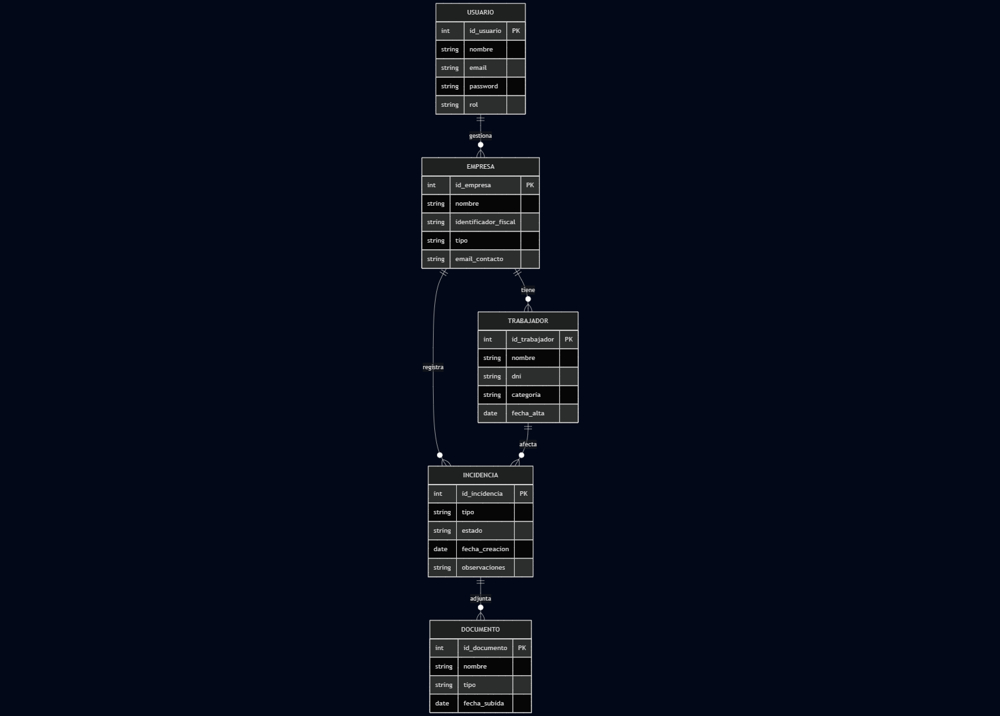

# Anteproyecto

## Aplicación de asesoramiento laboral

**Autor:** David Docampo
**Ciclo:** DAW — FCT/Proxecto (2025–2026)
**Centro:** IES San Clemente
**Fecha:** 23/01/2026

## Índice

- [Aplicación de asesoramiento laboral](#aplicación-de-asesoramiento-laboral)
- [Índice](#índice)
- [Estado de arte o análisis del contexto](#estado-de-arte-o-análisis-del-contexto)
- [Propósito](#propósito)
- [Objetivos](#objetivos)
- [Alcance](#alcance)
  - [Funcionalidades incluidas](#funcionalidades-incluidas)
  - [Usuarios y perfiles](#usuarios-y-perfiles)
  - [Contexto de aplicación](#contexto-de-aplicación)
  - [Exclusiones y límites](#exclusiones-y-límites)
  - [Posibles mejoras futuras](#posibles-mejoras-futuras)
- [Análisis](#análisis)
  - [Análisis del problema](#análisis-del-problema)
  - [Descripción del proyecto](#descripción-del-proyecto)
  - [Objetivos](#objetivos-1)
  - [Alcance](#alcance-1)
  - [Justificación del proyecto y estudio de necesidades](#justificación-del-proyecto-y-estudio-de-necesidades)
  - [Funcionalidades del proyecto y actores implicados](#funcionalidades-del-proyecto-y-actores-implicados)
  - [Tipos de usuarios](#tipos-de-usuarios)
  - [Modelo de negocio](#modelo-de-negocio)
  - [Normativa aplicable](#normativa-aplicable)
- [Diseño](#diseño)
  - [Mapa de navegación (rutas)](#mapa-de-navegación-rutas)
  - [Wireframe de la página principal (Home)](#wireframe-de-la-página-principal-home)
  - [Wireframe del Dashboard (/app)](#wireframe-del-dashboard-app)
  - [Wireframe de Empresas (/app/empresas)](#wireframe-de-empresas-appempresas)
  - [Wireframe de Incidencias (/app/incidencias)](#wireframe-de-incidencias-appincidencias)
  - [Wireframe de Perfil (/app/perfil)](#wireframe-de-perfil-appperfil)
  - [Diagrama de casos de uso](#diagrama-de-casos-de-uso)
  - [Modelo de datos (Diagrama E/R)](#modelo-de-datos-diagrama-er)
  - [Infraestructura y arquitectura técnica](#infraestructura-y-arquitectura-técnica)
    - [Componentes principales](#componentes-principales)
    - [Comunicación entre componentes](#comunicación-entre-componentes)
    - [Autenticación y autorización (nivel conceptual)](#autenticación-y-autorización-nivel-conceptual)
    - [Despliegue y ejecución en desarrollo (entorno local)](#despliegue-y-ejecución-en-desarrollo-entorno-local)
    - [Consideraciones de escalabilidad (conceptual)](#consideraciones-de-escalabilidad-conceptual)
- [Planificación](#planificación)
  - [Identificación de fases](#identificación-de-fases)
  - [Recursos (humanos y materiales)](#recursos-humanos-y-materiales)
  - [Infraestructura y entorno de desarrollo](#infraestructura-y-entorno-de-desarrollo)
    - [Componentes principales](#componentes-principales-1)
    - [Comunicación entre capas](#comunicación-entre-capas)
    - [Entorno local de desarrollo](#entorno-local-de-desarrollo)
    - [Estructura del repositorio (alto nivel)](#estructura-del-repositorio-alto-nivel)
  - [Planificación temporal (resumen)](#planificación-temporal-resumen)
  - [Estimación de esfuerzo y presupuesto](#estimación-de-esfuerzo-y-presupuesto)
  - [Metodología de trabajo](#metodología-de-trabajo)
  - [Riesgos y mitigación](#riesgos-y-mitigación)
  - [Modelo de negocio](#modelo-de-negocio-1)
  - [Normativa: protección de datos, obrigas fiscais e laborais, prevención de riscos e posibles axudas ou subvencións](#normativa-protección-de-datos-obrigas-fiscais-e-laborais-prevención-de-riscos-e-posibles-axudas-ou-subvencións)
    - [Protección de datos](#protección-de-datos)
    - [Obrigacións fiscais e laborais](#obrigacións-fiscais-e-laborais)
    - [Prevención de riscos laborais](#prevención-de-riscos-laborais)
    - [Posibles axudas ou subvencións](#posibles-axudas-ou-subvencións)

## Estado de arte o análisis del contexto

La aplicación está dirigida principalmente al ámbito del **asesoramiento laboral**, un sector que presta servicios, especialmente, a pequeñas y medianas empresas, así como a autónomos y profesionales que necesitan cumplir con sus obligaciones laborales y de seguridad social. Este tipo de asesorías gestionan habitualmente un volumen elevado de información relacionada con trabajadores, contratos, incidencias laborales y comunicaciones con distintos organismos públicos.

En muchos casos, la gestión de esta información se realiza mediante herramientas genéricas como hojas de cálculo, documentos de texto o aplicaciones no especializadas, lo que puede provocar errores, duplicidad de datos y dificultades en el seguimiento de los distintos procesos laborales. Esta situación se agrava especialmente en asesorías con múltiples clientes o empresas que gestionan plantillas con cierta rotación de personal.

La necesidad principal que se pretende cubrir con este proyecto es la **organización y centralización de la información laboral**, facilitando al asesor una visión clara del estado de cada empresa y de cada trabajador. Disponer de un sistema que permita registrar y consultar de forma estructurada los distintos procesos laborales (altas, bajas, variaciones de datos, vacaciones, incapacidades, etc.) contribuye a mejorar el control del trabajo diario y a reducir errores derivados de una gestión manual.

Existen actualmente aplicaciones comerciales orientadas a la gestión laboral y de recursos humanos, muchas de ellas integradas con sistemas oficiales o con funcionalidades avanzadas. Sin embargo, estas soluciones suelen resultar complejas, costosas o excesivamente amplias para pequeñas asesorías o empresas que solo necesitan un control básico y organizado de la información. Además, en un entorno académico, el acceso a estas herramientas no siempre es viable para fines de aprendizaje o demostración.

El desarrollo de esta aplicación abre una **oportunidad de mejora en la digitalización de la gestión laboral**, especialmente como herramienta de apoyo al trabajo del asesor. Aunque el proyecto no tiene como objetivo su comercialización directa, sí muestra cómo una solución web sencilla y bien estructurada puede aportar valor al sector, sirviendo como base para futuras ampliaciones o adaptaciones a entornos profesionales reales.

## Propósito

El propósito de este proyecto es el diseño y desarrollo de una **aplicación web de gestión orientada al asesoramiento laboral**, dirigida principalmente a pequeñas y medianas empresas, autónomos y asesorías laborales que necesiten organizar y controlar la información relacionada con la gestión de personal y sus obligaciones laborales.

La aplicación no tiene como objetivo realizar directamente trámites oficiales ante organismos públicos como la Seguridad Social, la Agencia Tributaria o el SEPE, sino **servir como una herramienta de apoyo al trabajo del asesor laboral**. Su función principal será facilitar la organización de la información, el seguimiento de procesos y la planificación de actuaciones laborales, ayudando al profesional a tomar decisiones con mayor control y seguridad. De este modo, la aplicación aporta valor al asesor laboral, al facilitar una visión clara y estructurada del estado de cada cliente y de sus obligaciones laborales, mejorando la eficiencia del servicio ofrecido.

El proyecto surge de la necesidad real de muchas asesorías y empresas de **centralizar la información laboral**, reducir errores derivados de la gestión manual y mejorar el seguimiento de actuaciones como altas y bajas de trabajadores, variaciones de datos, vacaciones, incapacidades u otras incidencias habituales. La aplicación permitirá registrar empresas, clientes y trabajadores, asociando a cada uno los distintos procesos laborales y su estado.

Este proyecto se plantea como una **aplicación funcional de demostración**, desarrollada en un entorno académico, que sirve como ejemplo de cómo una aplicación web puede aportar valor en el ámbito del asesoramiento laboral mediante la digitalización y organización de la información. La posible ampliación hacia funcionalidades más avanzadas, como la ejecución automática de trámites o la integración con plataformas oficiales, se considera una **línea de evolución futura**, fuera del alcance del presente proyecto.

En definitiva, el propósito del proyecto es crear una base sólida y estructurada que muestre de forma práctica cómo la tecnología puede apoyar el trabajo de una asesoría laboral, mejorando la organización, el control de la información y la eficiencia del servicio, dentro de unos límites realistas y acordes al contexto académico del desarrollo.

## Objetivos

El objetivo principal de este proyecto es desarrollar una aplicación web que sirva como herramienta de apoyo al asesoramiento laboral, permitiendo organizar y gestionar de forma estructurada la información relacionada con empresas, clientes y trabajadores, dentro de un entorno académico.

A partir de este objetivo general, se definen los siguientes objetivos específicos:

- Analizar las necesidades básicas de una asesoría laboral en relación con la gestión de información de trabajadores, empresas y procesos laborales habituales.

- Diseñar la estructura funcional de la aplicación, definiendo los distintos módulos y secciones necesarios para cubrir dichas necesidades (gestión de empresas, trabajadores, incidencias laborales, etc.).

- Desarrollar una interfaz web clara e intuitiva, orientada a facilitar el acceso y la consulta de la información laboral por parte del usuario.

- Implementar un prototipo funcional de la aplicación que permita registrar, visualizar y organizar información laboral mediante datos de prueba.

- Aplicar una arquitectura de aplicación web moderna, separando la lógica de presentación y la gestión de datos, siguiendo buenas prácticas de desarrollo.

- Documentar el proceso de análisis, diseño y desarrollo del proyecto, explicando las decisiones tomadas y justificando las soluciones adoptadas.

- Adquirir y consolidar conocimientos prácticos sobre el desarrollo de aplicaciones web, especialmente en el uso de tecnologías actuales y metodologías de trabajo orientadas a proyectos.

Estos objetivos servirán como referencia para guiar el desarrollo del proyecto y para evaluar el grado de cumplimiento del mismo en las distintas fases establecidas.

## Alcance

El alcance de este proyecto comprende el diseño y desarrollo de una **aplicación web de apoyo al asesoramiento laboral**, orientada a la **organización, registro y seguimiento interno de información** relacionada con empresas/clientes y sus trabajadores.

### Funcionalidades incluidas

La aplicación permitirá, como mínimo:

- **Gestión de empresas/clientes**, incluyendo el registro, listado y consulta de información básica.
- **Gestión de trabajadores** asociados a una empresa/cliente, permitiendo su registro, consulta y relación con incidencias laborales.
- **Registro y seguimiento de incidencias o expedientes laborales**, entendidos como **anotaciones internas de control**, que incluirán:
  - tipo de incidencia (altas, bajas, variaciones de datos, vacaciones, incapacidades, etc.),
  - fecha,
  - estado (pendiente, en curso, resuelta),
  - observaciones.

Estas incidencias no implican la realización de trámites oficiales, sino que representan **información orientativa y de seguimiento**, utilizada por el asesor para planificar actuaciones, realizar comprobaciones o preparar futuras gestiones administrativas fuera de la aplicación.

- **Navegación tipo SPA**, con páginas estructuradas para facilitar el acceso a la información.
- Interfaz web clara e intuitiva, orientada a facilitar el trabajo diario del asesor.

### Usuarios y perfiles

La aplicación contempla los siguientes tipos de usuario:

- **Asesoría (perfil gestor)**: responsable de registrar, consultar y actualizar la información de empresas, trabajadores e incidencias.
- **Cliente (empresa o autónomo)**: podrá consultar la información asociada a su cuenta, en caso de implementarse acceso autenticado.
- **Zona pública**: páginas informativas accesibles sin autenticación (inicio, contacto, información general).

Por limitaciones de tiempo y alcance, no se implementará un sistema avanzado de permisos; esta funcionalidad se considera una posible mejora futura.

### Contexto de aplicación

El proyecto se desarrolla en un **entorno académico** y se entrega como un **prototipo funcional**, utilizando datos de prueba. Su objetivo es demostrar la viabilidad organizativa y funcional de una herramienta de este tipo, no ofrecer una solución lista para producción.

La aplicación será una **web responsive (mobile-first)**, accesible desde navegadores actuales, sin desarrollo de aplicaciones móviles nativas.

### Exclusiones y límites

Queda fuera del alcance del proyecto:

- La realización de **trámites oficiales reales** ante organismos públicos (Seguridad Social, Agencia Tributaria, SEPE).
- La integración con plataformas oficiales, certificados digitales o firma electrónica.
- Automatizaciones administrativas reales.
- Seguridad avanzada (autenticación multifactor, firma digital, cifrado certificado).
- Implantación en un entorno productivo real.

### Posibles mejoras futuras

Como líneas de evolución futura, no incluidas en el alcance por limitaciones de tiempo y recursos, se plantean:

- Integración con servicios oficiales.
- Gestión avanzada de roles y permisos.
- Sección de recursos oficiales (Estatuto de los Trabajadores actualizado, convenios colectivos).
- Acceso guiado a calendarios laborales por provincia y convenio.

## Análisis

El análisis del proyecto tiene como objetivo identificar y definir de forma clara las necesidades que debe cubrir la aplicación, los perfiles de usuario implicados y los requisitos que el sistema debe cumplir. Este apartado sirve como base para las fases posteriores de diseño y desarrollo, asegurando que la solución propuesta responde de manera coherente al problema planteado.

### Análisis del problema

En el ámbito del asesoramiento laboral, una parte importante del trabajo diario consiste en manejar información relacionada con empresas, trabajadores y distintos procesos o incidencias laborales. En muchos casos, esa información está repartida entre documentos, hojas de cálculo y notas internas, lo que complica su consulta, su actualización y el seguimiento de tareas.

Cuando no existe un sistema centralizado, es fácil que aparezcan duplicidades, errores al copiar datos y pérdidas de tiempo buscando la información más actualizada o comprobando el estado de una incidencia. Estos problemas se acentúan especialmente cuando se gestionan varios clientes o cuando existen cambios frecuentes en las plantillas de trabajadores.

Especialmente en el caso de pequeñas empresas y autónomos, la gestión de las obligaciones laborales supone una carga significativa. En muchos casos, asumir internamente estas tareas implicaría la contratación de personal específico, a menudo a tiempo completo, lo que resulta inviable desde un punto de vista económico. Además, delegar estas funciones en personas sin la formación adecuada conlleva un riesgo elevado, ya que errores en materia laboral pueden derivar en sanciones, recargos o costes económicos importantes para la empresa.

Con este proyecto no se pretende automatizar trámites oficiales, sino **mejorar la organización y el control interno de la información laboral**. La idea es que el asesor laboral pueda disponer de una visión clara y estructurada de cada empresa y de sus trabajadores, así como llevar un seguimiento sencillo de incidencias habituales (altas, bajas, vacaciones, situaciones de incapacidad temporal, variaciones de datos, etc.), indicando su estado y observaciones.

### Descripción del proyecto

El proyecto consiste en el diseño y desarrollo de una **aplicación web de apoyo al asesoramiento laboral**, orientada a la organización y gestión interna de la información relacionada con empresas, clientes y trabajadores. La aplicación permitirá centralizar datos y realizar un seguimiento estructurado de los distintos procesos e incidencias laborales habituales, con el objetivo de mejorar el control y la eficiencia del trabajo diario del asesor.

Se trata de un proyecto desarrollado en un **entorno académico**, planteado como un **prototipo funcional**, que utiliza datos de prueba y no realiza trámites oficiales reales. La aplicación está concebida como una herramienta de apoyo organizativo, no como un sustituto de las plataformas oficiales de las administraciones públicas.

### Objetivos

El objetivo principal del proyecto es desarrollar una aplicación web que sirva como herramienta de apoyo al asesoramiento laboral, facilitando la organización y consulta de la información laboral de empresas y trabajadores.

Este objetivo general se concreta en los siguientes aspectos, ya definidos en el anteproyecto:

- Analizar las necesidades básicas de una asesoría laboral en relación con la gestión de información.
- Diseñar una estructura funcional clara y coherente.
- Implementar un prototipo funcional que permita registrar y consultar datos laborales.
- Aplicar buenas prácticas de desarrollo y documentar adecuadamente el proceso.

Los objetivos servirán como referencia para evaluar el grado de cumplimiento del proyecto a lo largo de las distintas fases de análisis, diseño y desarrollo.

### Alcance

El alcance del proyecto incluye el diseño y desarrollo de una aplicación web que permita la **gestión interna de información laboral**, como empresas, trabajadores e incidencias asociadas, mediante una interfaz web accesible desde navegadores actuales.

Quedan dentro del alcance la organización, registro y seguimiento de datos de forma orientativa, así como la navegación tipo SPA y una interfaz clara e intuitiva. Quedan expresamente fuera del alcance la realización de trámites oficiales, la integración con plataformas públicas, la automatización administrativa real y la implantación en un entorno productivo, tal y como se detalla en el apartado de alcance del anteproyecto.

### Justificación del proyecto y estudio de necesidades

Las pequeñas y medianas empresas, así como muchos trabajadores autónomos, necesitan cumplir con un conjunto de obligaciones laborales y administrativas que requieren conocimientos específicos y una atención constante. En muchos casos, asumir internamente estas tareas supondría contratar personal especializado, habitualmente a tiempo completo, lo que resulta **inviable desde el punto de vista económico** para gran parte de estas organizaciones.

Por este motivo, la externalización de la gestión laboral a través de asesorías especializadas es una práctica habitual. No obstante, incluso dentro de las propias asesorías, gran parte del trabajo diario se apoya en herramientas genéricas o en procedimientos manuales que no siempre facilitan una visión clara del estado de cada cliente o de cada incidencia laboral.

Este proyecto se justifica como una respuesta a la necesidad de **organizar, centralizar y estructurar la información laboral**, reduciendo el riesgo de errores, mejorando el seguimiento de tareas y aportando mayor seguridad en la gestión interna. Disponer de una herramienta específica de apoyo permite al asesor dedicar más tiempo al análisis y a la toma de decisiones, minimizando los problemas derivados de una gestión dispersa o poco sistematizada.

### Funcionalidades del proyecto y actores implicados

La aplicación se concibe como una herramienta de apoyo al asesoramiento laboral, centrada en la gestión interna de la información. Las principales funcionalidades previstas son:

- Registro y gestión de empresas o clientes.
- Registro y gestión de trabajadores asociados a cada empresa.
- Creación y seguimiento de incidencias o expedientes laborales, tales como altas, bajas, variaciones de datos, vacaciones o situaciones de incapacidad, tratadas como anotaciones internas de control.
- Consulta del estado de las incidencias y registro de observaciones asociadas a cada una.
- Acceso a información organizada mediante una navegación clara y estructurada.

Los actores que intervienen en estas funcionalidades son:

- El **asesor laboral**, como principal usuario del sistema.
- El **cliente (empresa o autónomo)**, en caso de habilitarse un acceso limitado a la consulta de su información.
- Usuarios no autenticados, en el caso de las secciones informativas públicas de la aplicación.

### Tipos de usuarios

La aplicación contempla los siguientes tipos de usuario:

- **Usuario asesor (perfil gestor)**:  
  Es el usuario principal del sistema. Puede crear, modificar y consultar empresas, trabajadores e incidencias laborales.

- **Usuario cliente (empresa o autónomo)**:  
  Podrá acceder a información asociada a su cuenta, siempre que se implemente un sistema de autenticación básica. Este acceso será de solo consulta.

- **Usuario público**:  
  Usuario sin autenticación, con acceso únicamente a páginas informativas generales.

Por razones de alcance y tiempo, no se implementará un sistema avanzado de roles y permisos, quedando esta funcionalidad como una posible mejora futura.

### Modelo de negocio

El proyecto se desarrolla en un **entorno académico** y no tiene como objetivo su comercialización directa. No obstante, el modelo planteado es compatible con una posible evolución hacia un producto orientado a asesorías laborales, bajo un esquema de:

- Suscripción mensual por asesoría.
- Licencias por número de clientes o trabajadores gestionados.
- Uso como herramienta interna personalizada para despachos profesionales.

Este planteamiento se incluye a nivel conceptual, sin desarrollo técnico ni comercial en la presente fase del proyecto.

### Normativa aplicable

Aunque la aplicación no realiza trámites oficiales ni gestiona datos reales en producción, el proyecto tiene en cuenta, a nivel conceptual, la normativa relacionada con el ámbito laboral y la protección de datos, entre la que se incluyen:

- **Protección de datos personales** (RGPD y LOPDGDD), especialmente en lo relativo al tratamiento de datos de trabajadores y empresas.
- **Normativa laboral básica**, como el Estatuto de los Trabajadores y los convenios colectivos.
- **Obligaciones fiscales y laborales**, en cuanto a la correcta gestión y conservación de la información.
- **Prevención de riesgos laborales**, considerada como parte del contexto general del asesoramiento laboral.

Estas normativas se contemplan como marco de referencia, sin implementación técnica específica en esta fase académica.

## Diseño

### Mapa de navegación (rutas)

A continuación se muestra el mapa de navegación de la aplicación, que representa de forma visual las rutas públicas y privadas, así como la jerarquía de acceso entre las distintas secciones. Este diagrama ha sido elaborado utilizando Mermaid y exportado como imagen para su inclusión en la documentación.

### Wireframe de la página principal (Home)

A continuación se presenta el wireframe de la página principal de la aplicación.  
Este esquema define la estructura general de la Home, las secciones principales y los puntos de interacción del usuario, sirviendo como guía para el diseño visual y la implementación posterior.

### Wireframe del Dashboard (/app)

El dashboard constituye la **pantalla principal de la aplicación tras la autenticación del usuario**. El acceso a esta área está reservado a usuarios con cuenta, que representan a **clientes (empresas o autónomos) y/o a la asesoría**, y que ya tienen servicios asociados dentro de la aplicación.

Su objetivo es ofrecer una **visión personalizada y resumida** de la información laboral relacionada con el usuario autenticado, mostrando únicamente los datos que le afectan directamente, como sus empresas, trabajadores, incidencias o estados de seguimiento. De este modo, el usuario puede consultar de forma rápida qué servicios tiene activos, el estado de sus gestiones y acceder a las principales funcionalidades sin necesidad de navegar por múltiples secciones.

El dashboard actúa, por tanto, como un **punto central de acceso** a la aplicación, facilitando la organización del trabajo diario y mejorando la experiencia de uso mediante información clara, contextualizada y accesos rápidos a las acciones más habituales.

### Wireframe de Empresas (/app/empresas)

La vista de empresas permite al usuario autenticado gestionar las empresas o clientes asociados a su cuenta, consultar información relevante y acceder a funcionalidades relacionadas como trabajadores e incidencias.

### Wireframe de Incidencias (/app/incidencias)

La vista de incidencias permite al usuario autenticado registrar y dar seguimiento a eventos o procesos laborales (altas, bajas, vacaciones, IT, variaciones de datos, etc.) como anotaciones internas de control. Incluye filtros para localizar rápidamente incidencias por empresa, trabajador, tipo, estado o fechas, y un listado con acciones frecuentes.

### Wireframe de Perfil (/app/perfil)

La pantalla de perfil centraliza la información básica de la cuenta autenticada y acciones habituales como actualizar preferencias y gestionar seguridad (por ejemplo, cambio de contraseña y cierre de sesión). En el contexto académico, se añade un bloque de avisos sobre uso de datos de prueba.

### Diagrama de casos de uso

El siguiente diagrama representa las interacciones principales entre los tipos de usuario y las funcionalidades clave de la aplicación.

### Modelo de datos (Diagrama E/R)

El siguiente diagrama E/R representa la estructura de datos principal de la aplicación, mostrando las entidades relevantes y sus relaciones. Este modelo sirve como base para el diseño de la base de datos relacional y la posterior implementación en PostgreSQL.

### Infraestructura y arquitectura técnica

La aplicación se plantea con una arquitectura web en tres capas, separando la interfaz de usuario, la lógica de negocio y la persistencia de datos. Esta separación facilita el mantenimiento, permite desarrollar cada parte de forma incremental y reduce el acoplamiento entre componentes.

#### Componentes principales

- **Frontend (SPA)**  
  Aplicación cliente desarrollada con **React + Vite**, accesible desde navegador.  
  Se encarga de la navegación, renderizado de vistas y validaciones básicas de formularios.

- **Backend (API REST)**  
  Servicio desarrollado con **Node.js + Express** que expone endpoints HTTP para gestionar los datos (empresas, trabajadores, incidencias, etc.).  
  Centraliza la lógica de negocio y valida las peticiones del cliente.

- **Base de datos (PostgreSQL)**  
  Sistema de persistencia relacional para almacenar la información del dominio (clientes/empresas, trabajadores, incidencias y usuarios).  
  El backend accede a la base de datos mediante un cliente PostgreSQL (p. ej. `pg`) y consultas parametrizadas.

#### Comunicación entre componentes

- El frontend se comunica con el backend mediante **peticiones HTTP** (GET, POST, PUT/PATCH, DELETE).
- El formato de intercambio de datos es **JSON**.
- La API devolverá códigos de estado HTTP adecuados (200, 201, 400, 401, 404, 500, etc.) y mensajes de error controlados.

#### Autenticación y autorización (nivel conceptual)

La zona privada (`/app`) estará protegida mediante autenticación. El enfoque previsto es un modelo **stateless** basado en **token**:

- El usuario inicia sesión y el backend devuelve un token (por ejemplo, **JWT**).
- El frontend envía el token en las peticiones a la API mediante la cabecera:
  `Authorization: Bearer <token>`
- El backend valida el token y aplica autorización básica (por ejemplo, acceso a datos asociados al usuario).

En esta fase, el planteamiento se recoge a nivel de diseño y se implementará de forma progresiva en los prototipos.

#### Despliegue y ejecución en desarrollo (entorno local)

Durante el desarrollo, los componentes se ejecutarán en local:

- Frontend: servidor de desarrollo de Vite (p. ej. `http://localhost:5173`)
- Backend: servidor Express (p. ej. `http://localhost:3000`)
- Base de datos: PostgreSQL local

La configuración de URLs y variables sensibles (por ejemplo, credenciales o secretos) se gestionará mediante variables de entorno.

#### Consideraciones de escalabilidad (conceptual)

Aunque el proyecto es académico, la arquitectura propuesta permite escalar de forma razonable:

- El **frontend** puede servirse como contenido estático.
- El **backend**, al ser stateless con token, podría ejecutarse en varias instancias detrás de un balanceador.
- La **base de datos** puede mejorar rendimiento mediante índices y optimización de consultas en los campos más utilizados.

## Planificación

La planificación del proyecto se ha realizado teniendo en cuenta el calendario oficial de entregas establecido en el aula virtual (Mestre), así como la duración total del proyecto, que abarca desde el 12 de enero de 2026 hasta el 16 de marzo de 2026, con presentación final el 20 de marzo de 2026.

El proyecto se estructura en fases progresivas que permiten validar resultados parciales en cada entrega, facilitando el seguimiento por parte del tutor y reduciendo los riesgos derivados del desarrollo.

### Identificación de fases

El desarrollo del proyecto se divide en las siguientes fases:

1. **Anteproyecto**
   - Definición inicial de la idea del proyecto.
   - Planteamiento general del problema y de la solución propuesta.
   - Entrega realizada el **23/01/2026**.

2. **Análisis, diseño y planificación**
   - Definición de requisitos y funcionalidades del sistema.
   - Identificación de actores y casos de uso.
   - Diseño del mapa de navegación, wireframes y modelo de datos (E-R).
   - Planificación técnica y temporal del proyecto.
   - **Entrega prevista: 06/02/2026**.

3. **Prototipo 1**
   - Preparación y validación del entorno de desarrollo.
   - Implementación inicial del frontend (estructura base, rutas y componentes principales).
   - Desarrollo de un primer prototipo funcional con navegación básica.
   - **Entrega prevista: 18/02/2026**.

4. **Prototipo 2**
   - Desarrollo del backend mediante una API REST.
   - Integración entre frontend y backend.
   - Implementación de las funcionalidades principales (operaciones CRUD).
   - **Entrega prevista: 02/03/2026**.

5. **Aplicación final y documentación**
   - Finalización de funcionalidades pendientes.
   - Pruebas, corrección de errores y mejoras de usabilidad.
   - Elaboración y revisión de la documentación técnica y funcional.
   - **Entrega final: 16/03/2026**.

6. **Preparación y presentación del proyecto**
   - Elaboración de la presentación final.
   - Preparación de la defensa y ensayos previos.
   - Entrega de la presentación: **19/03/2026**.
   - Exposición oral del proyecto: **20/03/2026**.

### Recursos (humanos y materiales)

**Recursos humanos**

- Un único desarrollador: **David Docampo Trabazo**, responsable del análisis, diseño, implementación, pruebas, documentación y defensa del proyecto.

**Recursos materiales y software**

- Equipo personal con sistema operativo Windows 11.
- Visual Studio Code como entorno de desarrollo.
- Control de versiones mediante Git y GitLab.
- Frontend desarrollado con React y Vite.
- Backend basado en Node.js y Express.
- Base de datos PostgreSQL.
- Herramientas de documentación y diagramado: Markdown y Mermaid.

### Infraestructura y entorno de desarrollo

La aplicación se desarrollará siguiendo una arquitectura web de tres capas, separando claramente la interfaz de usuario, la lógica de negocio y la persistencia de datos. Este enfoque facilita el desarrollo incremental, el mantenimiento del código y la validación progresiva de resultados en cada entrega.

#### Componentes principales

- **Frontend (SPA)**  
  Aplicación web desarrollada con **React y Vite**, responsable de la interfaz de usuario, la navegación y la interacción con el sistema. Se implementa como una _Single Page Application_ (SPA).

- **Backend (API REST)**  
  Servidor desarrollado con **Node.js y Express**, encargado de exponer una API REST para la gestión de datos (operaciones CRUD), aplicar validaciones y centralizar la lógica básica de negocio.

- **Base de datos**  
  **PostgreSQL**, utilizada para almacenar la información persistente del sistema, como empresas o clientes, trabajadores e incidencias laborales.

#### Comunicación entre capas

- El frontend consume la API del backend mediante peticiones HTTP (GET, POST, PUT, DELETE).
- El backend procesa las peticiones, interactúa con la base de datos y devuelve respuestas en formato JSON.
- Durante las fases iniciales del proyecto, algunas vistas del frontend pueden trabajar con datos simulados, hasta completar la integración con la base de datos real.

#### Entorno local de desarrollo

El proyecto se ejecuta en un entorno local de desarrollo, lo que permite iterar rápidamente y detectar errores de forma temprana:

- **Frontend**: ejecución mediante `npm run dev` (Vite), accesible desde el navegador en `http://localhost:<puerto>`.
- **Backend**: ejecución mediante Node.js y Express en un puerto independiente (por ejemplo, `http://localhost:3000`), con configuración de CORS para permitir la comunicación con el frontend.
- **Base de datos**: instancia local de PostgreSQL con una base de datos específica para desarrollo y datos de prueba.

#### Estructura del repositorio (alto nivel)

- `frontend/`: aplicación React (Vite), componentes, vistas y rutas.
- `backend/` (previsto): API REST desarrollada con Express.
- `doc/`: documentación del proyecto y diagramas.

### Planificación temporal (resumen)

| Fase                             | Periodo aproximado      |
| -------------------------------- | ----------------------- |
| Anteproyecto                     | 12/01/2026 – 23/01/2026 |
| Análisis, diseño y planificación | 24/01/2026 – 06/02/2026 |
| Prototipo 1                      | 07/02/2026 – 18/02/2026 |
| Prototipo 2                      | 19/02/2026 – 02/03/2026 |
| Aplicación final y documentación | 03/03/2026 – 16/03/2026 |
| Presentación                     | 17/03/2026 – 20/03/2026 |

### Estimación de esfuerzo y presupuesto

La dedicación estimada para el desarrollo completo del proyecto es la siguiente:

- Desarrollo del proyecto (análisis, diseño, implementación y documentación): **210 horas**
- Preparación de la presentación (3 días × 5 h/día): **15 horas**
- Preparación de la defensa y defensa del proyecto: **5 horas**

**Total de horas estimadas: 230 horas**

A efectos académicos, se realiza una estimación económica orientativa:

- Coste hora estimado: **20 € / hora**
- Coste total aproximado: **230 h × 20 € = 4.600 €**

Este cálculo tiene un carácter exclusivamente académico y sirve para contextualizar el esfuerzo realizado durante el desarrollo del proyecto.

### Metodología de trabajo

El proyecto se desarrolla siguiendo un enfoque incremental e iterativo, basado en:

- Avances progresivos con entregas parciales.
- Uso de control de versiones con commits frecuentes y descriptivos.
- Revisión continua de la documentación conforme evoluciona el desarrollo.
- Coordinación periódica con el tutor para validar decisiones técnicas y de alcance.

### Riesgos y mitigación

Durante el desarrollo del proyecto se han identificado los siguientes riesgos potenciales:

- **Exceso de alcance funcional**  
  _Mitigación:_ delimitación clara del alcance y priorización de un prototipo funcional viable.

- **Problemas de integración entre frontend y backend**  
  _Mitigación:_ desarrollo incremental y pruebas tempranas de comunicación entre capas.

- **Limitaciones de tiempo**  
  _Mitigación:_ planificación basada en entregas parciales y ajuste continuo de objetivos.

- **Complejidad técnica superior a la prevista**  
  _Mitigación:_ uso de tecnologías conocidas y bien documentadas, evitando soluciones innecesariamente complejas.

La identificación de estos riesgos permite anticipar posibles problemas y reducir su impacto en el desarrollo global del proyecto.

### Modelo de negocio

El presente proyecto se enmarca en un contexto académico, por lo que no persigue la creación de una empresa propia ni la comercialización directa del software. No obstante, resulta necesario describir el modelo de uso y valor que tendría la aplicación en un entorno real.

La aplicación está pensada para ser utilizada por asesorías laborales pequeñas o medianas, así como por profesionales autónomos del ámbito laboral, como herramienta interna de apoyo a la gestión de la información. Su objetivo principal es centralizar y organizar datos relacionados con empresas clientes, trabajadores e incidencias laborales, facilitando su consulta y seguimiento.

Desde el punto de vista del modelo de negocio, el software podría implantarse como:

- una aplicación interna instalada en la propia infraestructura de la asesoría, o
- un servicio web de uso privado, accesible únicamente por personal autorizado.

El valor que aporta la aplicación no se basa en la automatización de trámites oficiales ni en la sustitución de plataformas de la Administración, sino en:

- la mejora de la organización interna,
- la reducción de información dispersa,
- y el apoyo al trabajo diario del personal de la asesoría.

El modelo económico asociado sería el habitual en este tipo de soluciones:

- pago por licencia,
- suscripción periódica,
- o desarrollo a medida para una asesoría concreta.

En el contexto de este proyecto, dicho modelo se describe únicamente a nivel conceptual, ya que la aplicación se desarrolla con datos de prueba y con fines formativos, sin explotación comercial real.

### Normativa: protección de datos, obrigas fiscais e laborais, prevención de riscos e posibles axudas ou subvencións

El desarrollo de esta aplicación se realiza en un **entorno académico** y con **datos de prueba**, por lo que no se gestionan datos reales de carácter personal ni se realizan trámites oficiales. Aun así, se han tenido en cuenta las principales normativas que afectarían a una aplicación de este tipo en un entorno real, a nivel conceptual y formativo.

#### Protección de datos

En un contexto real, la aplicación estaría sujeta al **Reglamento General de Protección de Datos** (RGPD) y a la **Ley Orgánica de Protección de Datos Personales y Garantía de los Derechos Digitales** (LOPDGDD), al tratar información relativa a personas trabajadoras.
En este proyecto:

- no se utilizan datos reales,
- no se realiza tratamiento efectivo de información personal,
- y la aplicación se limita a un entorno de pruebas.

No obstante, se han tenido en cuenta principios básicos como:

- control de acceso mediante autenticación,
- separación de roles de usuario,
- y restricción del acceso a la información según permisos.

#### Obrigacións fiscais e laborais

La aplicación no sustituye ni automatiza las obligaciones legales de la asesoría frente a organismos oficiales (Seguridad Social, SEPE, Agencia Tributaria, etc.). Su finalidad es únicamente organizativa, como apoyo interno a la gestión de la información laboral.

Cualquier cumplimiento normativo real seguiría dependiendo de los procedimientos y herramientas oficiales correspondientes.

#### Prevención de riscos laborais

En un entorno profesional real, el desarrollo y mantenimiento de software implica considerar aspectos relacionados con la **prevención de riesgos laborales**, especialmente en trabajos con pantallas de visualización de datos (PVD).

Entre estos aspectos destacan:

- la _ergonomía_ del puesto de trabajo (silla, mesa y postura),
- una _iluminación_ adecuada que reduzca la fatiga visual,
- _condiciones ambientales_ correctas (temperatura, ventilación y confort),
- y la correcta _organización_ del tiempo de trabajo, incluyendo pausas periódicas.

En el contexto de este proyecto académico no se implementan medidas específicas relacionadas con la prevención de riesgos laborales, pero se reconoce este marco como parte del entorno real en el que se desarrollaría y utilizaría una aplicación de este tipo.

#### Posibles axudas ou subvencións

En un escenario real, la adopción de una herramienta de digitalización como la desarrollada en este proyecto podría encajar en programas de apoyo orientados a la modernización y digitalización de pequeñas y medianas empresas.

De forma general, podrían existir:

- programas de digitalización de pymes,
- líneas de apoyo a la innovación tecnológica,
- o subvenciones destinadas a la transformación digital del tejido empresarial.

En el marco de este proyecto académico no se tramitan ni se analizan subvenciones concretas, mencionándose este apartado únicamente para contextualizar la viabilidad y el encaje teórico de una solución de este tipo en un entorno profesional real.
